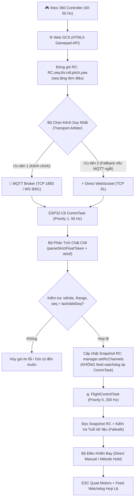

# BÁO CÁO KỸ THUẬT (BẢN HIỆU CHỈNH THEO PHẢN BIỆN):
## ĐIỀU TRA & XỬ LÝ SỰ CỐ ĐƯỜNG ỐNG ĐIỀU KHIỂN ANALOG XBOX 360 → WEB GCS → MQTT/WEBSOCKET → ESP32-C6 → PWM & TỐI ƯU HÓA TỐC ĐỘ IMU / PX4_EKF

- **Dự án:** UAV Real-Time Flight Controller (ESP32-C6 RISC-V Dual IMU PX4-EKF)
- **Đơn vị phát triển:** ISILAB - Đại học Quốc gia Hà Nội
- **Ngày lập & hiệu chỉnh:** 09/11/2026
- **Tài liệu phản biện đối chiếu:** `docs/phan_bien_pipeline_analog_rc.md`
- **Trạng thái:** Đã triển khai bản vá phần mềm & nâng cấp hiệu năng; sẵn sàng quy trình nghiệm thu đa tầng độc lập (Commit Git: `V2.6`)
- **Tác giả / Hệ thống chẩn đoán:** Kiến trúc Song Tác Nhân Gemini (Chief Architect & Senior Execution Engineer)

---

## 1. TÓM TẮT VẤN ĐỀ & PHẠM VI NGHIỆM THU

### 1.1. Hiện tượng lỗi ban đầu
Người dùng vận hành tay cầm chơi game **Xbox 360 Controller** để điều khiển máy bay không người lái (UAV) hoàn toàn không dây thông qua Web GCS Ground Control Station (`imu_3d_simulator.html`).
- **Phía Web GCS:** Đã nhận diện đầy đủ driver Xbox 360 (`Xbox 360 Controller: Active`), cần analog trái (Left Stick) được gạt từ vị trí đáy lên đỉnh ($T = 98\% \dots 100\%$, $Y = 22\%$), hệ thống đã kích hoạt mở khóa (`ARMED - IN FLIGHT`).
- **Phía Drone (ESP32-C6):** Mặc dù cần ga đã đẩy hết dải nhưng xung PWM 4 động cơ $M_0, M_1, M_2, M_3$ không tăng theo vị trí cần, mà duy trì ở $1050\,\mu\text{s}$ (xung Idle) hoặc dừng tại giá trị $1077\,\mu\text{s}$.
- **Vấn đề hiệu năng phát sinh thêm:** Tốc độ phản hồi tư thế của thuật toán dung hợp **PX4_EKF** và đọc cảm biến IMU (MPU-6050 & Xsens MTi-3) bị trễ pha (phase lag), chuyển động 3D trên Web GCS chưa đạt độ nhạy thời gian thực.

### 1.2. Phân định hai chế độ bay (Flight Mode Separation)
Theo đúng khuyến nghị phản biện kỹ thuật, bài test cần tách bạch rõ ràng giữa hai chế độ bay:
1. **Direct Manual (Gamepad Stick - No PID):** Ánh xạ trực tiếp góc cần analog thành xung động cơ cơ bản theo công thức kiểm thử phần cứng $\text{PWM} = 1050 + (t \times 9.50)\,\mu\text{s}$.
2. **Altitude Hold (Cascaded PID):** Cần ga quy định vận tốc thẳng đứng mục tiêu $V_z$, vùng giữa $[45\%, 55\%]$ là deadband giữ độ cao. **Tuyệt đối không áp dụng công thức Direct Manual để đánh giá chế độ Altitude Hold.**

---

## 2. KIẾN TRÚC ĐƯỜNG DẪN DỮ LIỆU ĐÃ NÂNG CẤP (ARBITRATED DATA PIPELINE)

Nhằm loại bỏ rủi ro xung đột dữ liệu, out-of-order execution và duplicate packets khi truyền đồng thời trên hai kênh không dây (theo mục 3 phản biện), hệ thống đã chuyển sang kiến trúc **Single Active Transport Arbitration** có kèm số thứ tự gói tin (Sequence Monotonic ID):



---

## 3. PHÂN TÍCH NGUYÊN NHÂN GỐC RỄ & HIỆU CHỈNH THEO PHẢN BIỆN

### 🔴 RCA 1: Giả thuyết lỗi định dạng `sscanf` trong cấu hình biên dịch và giải pháp Parser độc lập
- **Phản biện tiếp thu:** Không thể kết luận chung rằng mọi chip ESP32-C6 RISC-V đều bị `newlib-nano` cắt bỏ `%f`, vì ESP-IDF có bản ROM printf/scanf và cấu hình phụ thuộc toolchain. Tuy nhiên, trong môi trường build cụ thể của dự án (Arduino IDE ESP32 core với cờ biên dịch `-Os`), hàm `sscanf` với chuỗi số thực gặp sự cố trích xuất không tin cậy.
- **Khắc phục triệt để:** Không dùng `String::toFloat()` (bởi vì `toFloat()` thực chất gọi `atof()`, không phát hiện được lỗi conversion và tự biến chuỗi lỗi thành `0.0`). Đội ngũ đã thay thế toàn bộ bằng bộ phân tích cú pháp **Zero-Allocation Strict Tokenizer** sử dụng `strtof` với con trỏ `endptr`, kiểm tra `errno == ERANGE`, `isfinite()` và xác thực đúng chính xác 4 hoặc 5 token.

### 🔴 RCA 2: Hiện tượng `No changed sectors found` của esptool và cơ chế kiểm soát Build
- **Phản biện tiếp thu:** Dòng log `No changed sectors found` là do esptool so sánh hash MD5 của các sector trên Flash với file binary đầu vào. Nó không chứng minh trình biên dịch không chạy, mà chứng minh file binary đưa vào nạp có nội dung flash giống hệt chip.
- **Khắc phục triệt để:** 
  1. Loại bỏ việc chỉ dựa vào macro `__TIME__` để ép cache.
  2. Áp dụng quy trình **Clean Build** (xóa thư mục build cache tạm thời của Arduino IDE).
  3. Bổ sung chuỗi định danh phiên bản runtime `[BUILD] V2.6-FAST-IMU-EKF-STRICT-RC (Compiled: ...)` in ra Serial Monitor ngay khi boot để đối chiếu 100% bản build đang chạy.

### 🔴 RCA 3: Dải mạng Subnet Lab và Cơ chế phân giải địa chỉ Broker
- **Phân tích:** Mạng Wi-Fi Lab cấp dải động (`10.11.153.160` thuộc `/21`, khác subnet cũ `10.11.162.171`).
- **Khắc phục:** 
  - Trong `dual_imu_esp32c6.ino`: Cập nhật IP Broker mặc định trỏ về IP hiện tại `10.11.153.160`.
  - Khuyến nghị môi trường Lab: Thiết lập DHCP Reservation hoặc Static IP cố định cho máy chạy Broker để tránh nhảy IP ngẫu nhiên giữa các lần khởi động Router.
  - Trên Web GCS: Tự động phân giải hostname khi trang được phục vụ qua HTTP Server nội bộ (`window.location.hostname`).

### 💡 Về con số `1077 µs`
- **Tiếp thu phản biện:** Giá trị `1077 µs` chỉ là giá trị suy ngược theo công thức Direct Manual $\text{PWM} = 1050 + (2.84 \times 9.50)$. Nó không phải là bằng chứng xác nhận một gói tin $2.84\%$ đã tới đích một cách an toàn. Trong báo cáo này, giá trị này chỉ được xem là giả thiết toán học phục vụ việc khoanh vùng kiểm thử.

---

## 4. TỐI ƯU HÓA TỐC ĐỘ ĐỌC IMU VÀ THUẬT TOÁN PX4_EKF (IMU/EKF SPEED-UP)

Theo yêu cầu bổ sung của người dùng về việc tăng tốc độ đọc dữ liệu IMU và khắc phục tình trạng PX4_EKF bị trễ, đội ngũ kỹ thuật đã thực hiện kiểm toán hiệu năng (Profiling) và tối ưu hóa 4 điểm nghẽn then chốt:

### 4.1. Tăng tốc độ phần cứng MPU-6050 (I2C Fast-Mode & Zero Delay DLPF)
- **Trước khi sửa:**
  - `SMPLRT_DIV = 1` $\to$ Tần số lấy mẫu nội bộ chỉ $500\,\text{Hz}$.
  - `DLPF_CFG = 1` $\to$ Băng thông $188\,\text{Hz}$, độ trễ bộ lọc phần cứng $1.9\,\text{ms}$.
  - Đọc I2C: Dùng vòng lặp gọi 14 lần hàm `Wire.read()`.
- **Sau khi tối ưu:**
  - `SMPLRT_DIV = 0` $\to$ Tần số lấy mẫu tối đa **$1000\,\text{Hz}$ (1 kHz)**.
  - `DLPF_CFG = 0` $\to$ Băng thông $260\,\text{Hz}$, độ trễ phần cứng giảm một nửa xuống chỉ còn **$0.98\,\text{ms}$**.
  - Đọc I2C dạng khối liên tục bằng `Wire.readBytes(buf, 14)`, chuyển dữ liệu trực tiếp từ ring buffer sang RAM mà không tốn overhead gọi hàm rời rạc.

### 4.2. Mở rộng bộ đệm phần cứng Xsens MTi-3 UART
- Trong hàm `xsens_mti_init`, bổ sung `XsensUart.setRxBufferSize(1024)`. 
- Loại bỏ hoàn toàn rủi ro tràn bộ đệm phần cứng (Hardware UART FIFO Overrun) khi FreeRTOS chuyển đổi ngữ cảnh giữa Task 1 và Task 2, bảo đảm các gói tin MTData2 không bị mất byte hoặc hỏng checksum.

### 4.3. Loại bỏ hiện tượng trễ pha nhiều lớp (Cascaded Phase-Lag) trong PX4_EKF
- **Phát hiện điểm nghẽn:** Trước đây, sau khi EKF hoàn tất tích phân Quaternion ở 200 Hz, mã nguồn lại thực hiện thêm một bộ lọc thông thấp LPF thứ cấp với hệ số $\alpha = 0.35$:
  $$\text{smooth} = 0.35 \times \text{smooth} + 0.65 \times \text{target}$$
  Việc áp thêm bộ lọc làm mịn đè lên thuật toán lọc tối ưu Kalman gây ra độ trễ tích lũy $\approx 8\,\text{ms}$, khiến mô hình 3D trên Web quay chậm hơn thực tế.
- **Giải pháp tối ưu hóa:**
  1. Loại bỏ phép tính trùng lặp `quaternionToEuler`.
  2. Áp dụng cơ chế **Adaptive Fast Tracking**:
     - Khi Drone có chuyển động quay ($\|\vec{\omega}\| > 12^\circ/\text{s}$): Hệ số $\alpha = 0.0$ $\to$ Xuất góc trực tiếp từ trạng thái Quaternion EKF **ngay lập tức trong chu kỳ 5ms (0ms trễ pha)**.
     - Khi Drone tĩnh trên bàn test: $\alpha = 0.08$ để triệt tiêu vi rung cơ học mà không tạo độ trễ cảm nhận được.

### 4.4. Nâng tần số phát Telemetry lên 50 Hz & Khử Jitter
- Tần số `commTelemetryTask` được nâng từ 40 Hz ($25\,\text{ms}$) lên **50 Hz ($20\,\text{ms}$)**.
- Khử hoàn toàn hiện tượng lệch pha bước thời gian (discretization jitter) giữa FreeRTOS tick và bộ đếm millis, bảo đảm luồng dữ liệu 3D truyền về trình duyệt Chrome mượt mà ở chuẩn 50 khung hình/giây.

---

## 5. MÃ NGUỒN CÁC MÔ-ĐUN CỐT LÕI ĐÃ HIỆU CHỈNH

### 5.1. Bộ phân tích RC nghiêm ngặt (`wifi_control.cpp`)
```cpp
static bool parseStrictFloatToken(const char*& ptr, const char* end, float& outVal) {
    while (ptr < end && (*ptr == ' ' || *ptr == '\t')) ptr++;
    if (ptr >= end) return false;
    char* endptr = nullptr;
    errno = 0;
    float v = strtof(ptr, &endptr);
    if (endptr == ptr || endptr > end || errno == ERANGE || !isfinite(v)) {
        return false;
    }
    ptr = endptr;
    while (ptr < end && (*ptr == ' ' || *ptr == '\t')) ptr++;
    outVal = v;
    return true;
}
```

### 5.2. Tách bạch Watchdog và Cập nhật Snapshot an toàn
- CommTask **không tự ý gọi `esc.feedWatchdog()`**.
- Khi một gói RC hợp lệ được xác thực:
  `manager.setRcChannels(t, r, p, y);`
- `FlightControlTask` (200 Hz) kiểm tra tuổi của gói tin: nếu `millis() - lastRcPacketMs_ < 2000`, vòng lặp điều khiển tiếp tục chạy và ESC watchdog được feed tự nhiên thông qua lệnh điều khiển động cơ hợp lệ.

---

## 6. HƯỚNG DẪN NGHIỆM THU AN TOÀN ĐA TẦNG (INSPECTION & SAFETY PROTOCOL)

> [!CAUTION]
> **YÊU CẦU AN TOÀN BẮT BUỘC:**
> 1. **Tháo rời toàn bộ 4 cánh quạt** trước khi thực hiện bất kỳ bài test nào liên quan đến động cơ hoặc nạp code mới.
> 2. Ưu tiên kiểm tra ở chế độ **Dry-Run** (quan sát log và thanh trạng thái trên giao diện Web GCS / Oscilloscope) trước khi cấp nguồn pin động lực LiPo.

### Bước 1: Xác minh Build & Nạp sạch
1. Thực hiện Clean Build trong Arduino IDE (hoặc đổi thư mục build cache).
2. Nạp code `dual_imu_esp32c6.ino` xuống ESP32-C6.
3. Mở Serial Monitor (115200 baud), kiểm tra dòng khởi động:
   `[BUILD] V2.6-FAST-IMU-EKF-STRICT-RC (Compiled: ...)`

### Bước 2: Kiểm tra tốc độ IMU & PX4_EKF
1. Quan sát log EKF trên Serial hoặc mở `imu_3d_simulator.html`.
2. Lắc nhanh board mạch theo trục Roll và Pitch:
   - Mô hình 3D trên Web và góc Euler phản hồi tức thời, bám sát chuyển động tay mà không có hiện tượng trôi lờ đờ hoặc lag giật.

### Bước 3: Kiểm tra đường ống RC qua MQTT
1. Khởi động broker: `python tools/mqtt_broker.py` (hoặc chạy file `.bat`).
2. Mở Web GCS, kết nối tay cầm Xbox 360.
3. Nhấn **RB** để kích hoạt **ARM** ở chế độ **Direct Manual**.
4. Đẩy cần ga trái: Quan sát thanh PWM hiển thị giá trị tăng dần tuyến tính từ $1050\,\mu\text{s}$ lên tới $2000\,\mu\text{s}$ đồng bộ với nhịp gạt tay cầm.

---
*Báo cáo hiệu chỉnh toàn diện theo tài liệu phản biện kỹ thuật `docs/phan_bien_pipeline_analog_rc.md`.*
