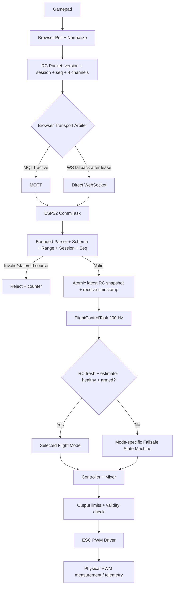

# PHẢN BIỆN KỸ THUẬT V2.6
## Rà soát đường ống RC Analog, MQTT/WebSocket, PWM và tối ưu IMU/EKF trên ESP32-C6

- **Tài liệu được rà soát:** `ANALOG_RC_PIPELINE_DEBUG_REPORT(1).md`
- **Phạm vi:** Kiểm tra lập luận, phát hiện lỗi logic còn lại, đề xuất sửa firmware và quy trình nghiệm thu.
- **Cơ sở:** Nội dung báo cáo và mã giả được trích trong tài liệu; chưa có repository/25 tệp mã nguồn để xác minh implementation, commit hay kết quả chạy thực tế.
- **Trạng thái review:** Có thể dùng làm checklist sửa code/bench test; **không phải chứng nhận an toàn bay**.

---

# 1. Kết luận điều hành

Bản V2.6 đã tiếp thu đúng một số phản biện: không kết luận chung rằng mọi ESP32-C6 đều lỗi `sscanf("%f")`; bỏ `String::toFloat()` làm parser nghiêm ngặt; phân biệt Direct Manual với Altitude Hold; đưa sequence vào gói RC; hướng tới single-active-transport; và chuyển kiểm tra tuổi RC sang FlightControlTask.

Tuy nhiên, vẫn còn các lỗi/thiếu bằng chứng sau:

| Mức | Vấn đề | Kết luận review |
|---|---|---|
| **CRITICAL** | `RC timeout = 2000 ms` | Quá dài cho luồng RC 50 Hz; phải thiết kế lại failsafe |
| **CRITICAL** | `DLPF_CFG=0`, `SMPLRT_DIV=0` được ghi là 1 kHz | Sai: gyro output rate là 8 kHz; accelerometer vẫn 1 kHz |
| **CRITICAL** | Direct Manual đưa throttle trực tiếp lên 1050–2000 µs | Chỉ phù hợp bench/no-prop, không phải chế độ bay ổn định |
| **HIGH** | Parser `strtof` chưa chứng minh an toàn theo biên payload | `strtof` cần chuỗi NUL-terminated; cần buffer có giới hạn và kiểm tra token chính xác |
| **HIGH** | `RC,seq,thr,roll,pitch,yaw` nhưng báo cáo nói 4 hoặc 5 token | Phải đặc tả rõ 5 trường số sau `RC,` (seq + 4 kênh) |
| **HIGH** | Sequence không có session/boot ID và transport ownership | Có thể reject lệnh sau reload/reconnect hoặc nhận lẫn nguồn |
| **HIGH** | `setRxBufferSize(1024)` được mô tả là loại bỏ hoàn toàn UART overrun | Chỉ tăng software RX ring buffer; không đảm bảo không mất byte |
| **HIGH** | Adaptive filter được mô tả là 0 ms phase lag | Không có lọc bổ sung không đồng nghĩa toàn pipeline trễ 0 ms |
| **HIGH** | Telemetry 50 Hz được coi là Chrome 50 FPS và hết jitter | Tần số gửi gói không đảm bảo FPS render hoặc không có jitter |
| **HIGH** | Thiếu chi tiết nguồn altitude/Vz và cách dung hợp hai IMU | Chưa đủ căn cứ xác nhận Altitude Hold/Dual IMU đã hoàn thiện |
| **MEDIUM** | MQTT IP vừa hard-code vừa cấu hình động qua WebSocket | Có thể có vòng phụ thuộc bootstrap/circular dependency |
| **MEDIUM** | `No changed sectors found` bị coi là build-cache failure | Chỉ nói sector cần ghi giống flash; không chứng minh compiler không chạy |
| **MEDIUM** | “V2.6” được ghi là Commit Git | Cần phân biệt version/tag với commit SHA đầy đủ |

**Kết luận:** Chưa nên giữ các nhãn “nghiệm thu thành công”, “PASS 100%”, “khắc phục triệt để” nếu chưa kèm log, cấu hình build, dữ liệu đo và phép thử có thể tái lập. Nên ghi “đã triển khai bản vá, chờ nghiệm thu độc lập”.

---

# 2. Phản biện đường ống RC và transport

## 2.1. Single Active Transport: đúng hướng nhưng chưa đủ

Báo cáo đưa MQTT làm kênh chính và WebSocket trực tiếp làm fallback. Không nên cho hai nguồn cùng ghi RC vào flight controller. Tuy nhiên, chỉ chọn kênh ở browser chưa đủ; ESP32 cũng phải xác nhận nguồn nào đang sở hữu phiên điều khiển.

### Rủi ro còn lại

1. **Browser reload:** sequence quay về 0 trong khi ESP32 vẫn giữ `lastValidSeq` lớn, khiến lệnh mới bị xem là cũ.
2. **ESP32 reboot:** sequence/session cũ có thể bị nhận nhầm nếu trạng thái receiver không được khởi tạo theo session mới.
3. **MQTT QoS 1:** broker có thể giao lại duplicate; sequence phải loại được gói lặp.
4. **Retained RC:** retained message có thể phát lại lệnh RC cũ khi subscribe/reconnect. Topic điều khiển RC phải `retain=false`.
5. **Fallback race:** MQTT cũ có thể vẫn còn gói đang xếp hàng khi browser đã chuyển qua WebSocket.
6. **Không có transport ownership:** gói của nguồn cũ có thể ghi đè nguồn mới.

### Giao thức khuyến nghị

Dùng một schema cố định, có phiên và thứ tự:

```text
RC,2,<session_id>,<seq>,<throttle>,<roll>,<pitch>,<yaw>\n
```

- `2`: version giao thức.
- `session_id`: ID mới khi browser bắt đầu phiên điều khiển.
- `seq`: số nguyên tăng đơn điệu trong session.
- `throttle`: 0..100 (%).
- `roll/pitch/yaw`: thống nhất -100..100 (% normalized); không trộn với -1..1.
- ESP32 chỉ nhận gói thuộc `active_session_id` và `active_transport`.
- Chỉ đổi transport sau handshake/lease; không tự nhận cả hai luồng đồng thời.
- Gói MQTT RC đặt `retain=false`; nếu dùng QoS 1 phải deduplicate theo session + sequence.

So sánh sequence `uint32_t` trong cùng session:

```cpp
static bool isSeqNewer(uint32_t candidate, uint32_t previous) {
    return static_cast<int32_t>(candidate - previous) > 0;
}
```

Chỉ dùng cách so sánh này khi khoảng cách sequence không vượt nửa miền `uint32_t`. Khi đổi session phải reset sequence baseline một cách có kiểm soát.

## 2.2. Mâu thuẫn cấu hình IP Broker

Báo cáo vừa ghi IP broker mặc định `10.11.153.160`, vừa nói browser gửi `MQTT,IP,1883` qua WebSocket trực tiếp tới ESP32. Nếu WebSocket trực tiếp chưa kết nối thì ESP32 lấy IP mới bằng cách nào để kết nối MQTT? Đây là vòng phụ thuộc bootstrap.

### Hướng khắc phục

Ưu tiên một trong các phương án:

- DHCP reservation cho máy chạy broker;
- hostname/DNS nội bộ hoặc mDNS nếu mạng hỗ trợ ổn định;
- cấu hình broker endpoint qua Serial/config file trước khi bật RC;
- provisioning AP riêng để cấu hình broker.

Không dùng kênh fallback chưa chắc hoạt động làm kênh duy nhất để cấp thông tin cần cho kênh chính.

`window.location.hostname` chỉ phản ánh hostname của trang web. Nếu mở trang bằng `file://`, hostname thường rỗng và fallback `127.0.0.1` là loopback của máy chạy browser, không phải ESP32 hay broker trên máy khác. Cần quy định rõ cách mở GCS (HTTP server hay file local).

Đối với mạng `/21`, `10.11.153.160` thuộc mạng `10.11.152.0/21`, còn `10.11.162.171` thuộc `10.11.160.0/21`. Hai địa chỉ nằm ở hai subnet khác nhau; điều đó chưa tự chứng minh không thể liên lạc, vì router có thể định tuyến giữa VLAN/subnet. Phải đo kết nối và kiểm tra firewall/route.

## 2.3. Kiểm tra mạng trước khi đụng firmware

Trên Windows PowerShell:

```powershell
ipconfig
route print
Test-NetConnection 10.11.153.160 -Port 1883
Test-NetConnection 10.11.153.160 -Port 9001
```

- Port 1883: MQTT TCP từ ESP32 tới broker.
- Port 9001: MQTT over WebSocket từ browser tới broker, nếu broker cấu hình listener này.
- Port 81: WebSocket trực tiếp tới ESP32, nếu firmware thực sự mở server ở port này.

Không suy ra một port hoạt động chỉ từ trạng thái `Online` của port khác.

---

# 3. Parser RC: lỗi cần sửa trong đoạn `strtof`

## 3.1. Điểm tốt

Dùng `strtof` + `endptr` + `errno` + `isfinite` có thể tạo parser nghiêm ngặt hơn `String::toFloat()`. `String::toFloat()` trong Arduino-ESP32 gọi `atof()`, và giá trị trả về 0 không phân biệt được chuỗi `0` hợp lệ với token không chuyển đổi được.

Tuy nhiên, `strtof` vẫn là hàm thư viện C; nó chỉ tránh nhánh đặc thù `scanf` của `sscanf`, không “độc lập runtime C”.

## 3.2. Lỗi biên bộ nhớ

Đoạn:

```cpp
float v = strtof(ptr, &endptr);
if (endptr == ptr || endptr > end || errno == ERANGE || !isfinite(v)) {
    return false;
}
```

không tự giới hạn vùng mà `strtof` được phép đọc. `strtof` cần chuỗi NUL-terminated. Nếu payload nhận qua network không có byte `\0` ở cuối buffer, hàm có thể đọc vượt cuối payload trước khi `endptr > end` được kiểm tra.

**Sửa:** kiểm tra chiều dài payload, từ chối embedded NUL, copy vào buffer cố định có chỗ cho terminator, rồi mới gọi `strtof`. Sau mỗi token phải bắt đúng dấu phân cách và sau token cuối phải hết dữ liệu (ngoại trừ CR/LF/space được cho phép).

## 3.3. Lỗi số lượng token

Schema `RC,seq,thr,roll,pitch,yaw` có **5 trường số** sau tiền tố `RC,`: một sequence integer và bốn float. Báo cáo nói parser xác thực “đúng 4 hoặc 5 token” chưa rõ là tính cả sequence hay không.

Không nên chấp nhận đồng thời format cũ 4 kênh và format mới có sequence nếu không có version giao thức. Hãy định nghĩa một format duy nhất và reject packet thiếu/thừa token.

## 3.4. Mẫu parser bounded, kiểm tra đúng số trường

Ví dụ dưới đây minh họa parser ASCII có giới hạn. Nó giả định protocol `RC,seq,thr,roll,pitch,yaw`, session/transport được kiểm tra ở lớp trước hoặc bổ sung thành field riêng.

```cpp
#include <cerrno>
#include <cmath>
#include <cstdint>
#include <cstdlib>
#include <cstring>
#include <limits>

struct RcPacket {
    uint32_t seq{};
    float throttle{};
    float roll{};
    float pitch{};
    float yaw{};
};

static void skipSpaces(char*& p) {
    while (*p == ' ' || *p == '\t') ++p;
}

static bool parseUInt32(char*& p, uint32_t& out, char delimiter) {
    skipSpaces(p);
    if (*p == '-' || *p == '+') return false;

    errno = 0;
    char* endPtr = nullptr;
    const unsigned long value = strtoul(p, &endPtr, 10);
    if (endPtr == p || errno == ERANGE ||
        value > std::numeric_limits<uint32_t>::max()) {
        return false;
    }
    p = endPtr;
    skipSpaces(p);
    if (*p != delimiter) return false;
    ++p;
    out = static_cast<uint32_t>(value);
    return true;
}

static bool parseFloatField(char*& p, float& out, char delimiter) {
    skipSpaces(p);
    errno = 0;
    char* endPtr = nullptr;
    const float value = strtof(p, &endPtr);

    if (endPtr == p || errno == ERANGE || !std::isfinite(value)) {
        return false;
    }
    p = endPtr;
    skipSpaces(p);
    if (*p != delimiter) return false;
    if (delimiter != '\0') ++p;
    out = value;
    return true;
}

static bool parseRcPacket(const uint8_t* payload,
                          size_t payloadLen,
                          RcPacket& out) {
    constexpr size_t MAX_PACKET = 96;
    if (payload == nullptr || payloadLen == 0 ||
        payloadLen >= MAX_PACKET) return false;
    if (std::memchr(payload, '\0', payloadLen) != nullptr) return false;

    char buf[MAX_PACKET];
    std::memcpy(buf, payload, payloadLen);
    buf[payloadLen] = '\0';

    // Cho phep bo CR/LF cuoi payload, khong bo qua token thua.
    while (payloadLen > 0 &&
           (buf[payloadLen - 1] == '\r' || buf[payloadLen - 1] == '\n')) {
        buf[--payloadLen] = '\0';
    }

    char* p = buf;
    if (std::strncmp(p, "RC,", 3) != 0) return false;
    p += 3;

    RcPacket tmp{};
    if (!parseUInt32(p, tmp.seq, ',')) return false;
    if (!parseFloatField(p, tmp.throttle, ',')) return false;
    if (!parseFloatField(p, tmp.roll, ',')) return false;
    if (!parseFloatField(p, tmp.pitch, ',')) return false;
    if (!parseFloatField(p, tmp.yaw, '\0')) return false;

    // Range theo protocol da chot; khong tu dong clamp packet loi.
    if (tmp.throttle < 0.0f || tmp.throttle > 100.0f) return false;
    if (tmp.roll < -100.0f || tmp.roll > 100.0f) return false;
    if (tmp.pitch < -100.0f || tmp.pitch > 100.0f) return false;
    if (tmp.yaw < -100.0f || tmp.yaw > 100.0f) return false;

    out = tmp; // chi commit sau khi toan bo packet hop le
    return true;
}
```

**Lưu ý:** Đây là ví dụ parser cho packet được NUL-terminate nội bộ sau khi copy. Nếu thêm `session_id` hoặc protocol version thì phải sửa schema và parser đồng bộ. Không đưa trực tiếp packet chưa được giới hạn chiều dài từ TCP/WebSocket vào `strtof`.

## 3.5. Kiểm thử parser bắt buộc

| Input | Kết quả mong muốn |
|---|---|
| `RC,1,50,0,0,0` | Accept |
| `RC,2,98,-10,5,22` | Accept nếu đúng range đã định nghĩa |
| `RC,3,nan,0,0,0` | Reject |
| `RC,4,inf,0,0,0` | Reject |
| `RC,5,101,0,0,0` | Reject |
| `RC,6,50abc,0,0,0` | Reject |
| `RC,7,50,0,0` | Reject thiếu field |
| `RC,8,50,0,0,0,extra` | Reject thừa field |
| Payload quá dài / embedded NUL | Reject |
| Sequence trùng hoặc cũ | Reject ở lớp sequence, không cập nhật timestamp hợp lệ |

Không được cập nhật `lastValidRcMs` hoặc watchdog chỉ vì parser nhìn thấy tiền tố `RC,`. Chỉ cập nhật sau khi packet đúng schema, đúng session/transport, sequence mới, finite và đúng range.

---

# 4. RC snapshot, task ownership và watchdog

## 4.1. Không feed watchdog từ CommTask là đúng hướng

CommTask chỉ nên parse, xác thực và cập nhật snapshot RC mới nhất. FlightControlTask mới quyết định dữ liệu đó có còn fresh và có thể dùng để điều khiển hay không.

Tuy nhiên, cần tách ba thứ khác nhau:

1. **RC freshness watchdog:** phát hiện mất lệnh RC.
2. **Flight task watchdog/TWDT:** phát hiện task bị treo hoặc không yield.
3. **ESC output watchdog:** phát hiện đầu ra điều khiển không được cập nhật theo cơ chế ESC/firmware.

Không dùng một hàm `feedWatchdog()` chung để biểu diễn cả ba.

ESP-IDF TWDT giám sát task/user đã đăng ký; task đó phải tự reset watchdog theo chu kỳ khi thực sự hoàn thành công việc được giám sát. Không nên feed TWDT chỉ vì gói RC đến. Ngược lại, FlightControlTask vẫn cần duy trì giám sát task ngay cả khi RC bị mất và hệ thống đang thực hiện failsafe.

## 4.2. RC timeout 2000 ms là lỗi nghiêm trọng

Với RC 50 Hz, một gói cách nhau 20 ms. Timeout 2000 ms tương đương khoảng 100 chu kỳ gói bị mất. Trong thời gian đó hệ thống có thể tiếp tục dùng setpoint cũ.

Không có một con số timeout dùng chung cho mọi UAV. Cần chọn dựa trên jitter/packet-loss thực tế và phân tích rủi ro. Với bench test 50 Hz, có thể bắt đầu thử các ngưỡng ngắn theo số gói mất (ví dụ 3–5 chu kỳ, 60–100 ms), sau đó đo p99/p99.9 jitter và kiểm tra false failsafe. Giá trị bay thực phải được xác nhận qua thử nghiệm riêng; không dùng 2 giây chỉ vì tiện.

Ví dụ logic:

```cpp
const uint32_t ageMs = nowMs - rcSnapshot.receivedAtMs; // phep tru unsigned wrap-safe
if (!rcSnapshot.valid || ageMs > RC_TIMEOUT_MS) {
    enterRcFailsafe();
} else {
    runSelectedFlightMode(rcSnapshot);
}
```

`enterRcFailsafe()` phải là state machine theo mode và health estimator, không được tùy tiện cắt toàn bộ motor. Mất RC khi estimator còn tốt có thể có hành động khác mất IMU/nguồn; hành động cụ thể phải được định nghĩa và kiểm chứng.

## 4.3. Snapshot phải nguyên tử

Không nên để CommTask ghi lần lượt bốn float trong khi FlightControlTask đọc giữa chừng; có thể tạo một RC command “lai” gồm throttle của packet mới và roll/pitch/yaw của packet cũ.

Dùng một struct có sequence + timestamp + source, và bảo vệ việc copy bằng queue/latest-value mailbox hoặc critical section cực ngắn:

```cpp
struct RcSnapshot {
    uint32_t seq;
    uint32_t receivedAtMs;
    float throttle;
    float roll;
    float pitch;
    float yaw;
    bool valid;
};
```

Không giữ critical section trong lúc parse, chạy PID, gửi mạng hoặc ghi Serial.

## 4.4. Quy tắc feed

- CommTask: không feed ESC watchdog; chỉ cập nhật snapshot nếu packet hợp lệ.
- FlightControlTask: kiểm tra RC freshness + estimator health + arming/mode; tính output; kiểm tra output; ghi phần cứng.
- TWDT: task tự feed theo chu kỳ nếu hoàn thành vòng công việc và không bị treo; không phụ thuộc riêng RC packet.
- ESC hardware/output timeout: cấu hình riêng theo tài liệu ESC và driver.

---

# 5. Kiểm toán tối ưu MPU-6050

## 5.1. Lỗi cấu hình tốc độ lấy mẫu trong báo cáo

Báo cáo ghi:

```text
SMPLRT_DIV = 0
DLPF_CFG   = 0
=> Sample rate = 1 kHz
```

Đây là **sai** theo MPU-6000/MPU-6050 Register Map:

- Khi DLPF disabled (`DLPF_CFG = 0` hoặc 7), gyro output rate là 8 kHz.
- Khi DLPF enabled, gyro output rate là 1 kHz.
- Công thức: `Sample Rate = Gyroscope Output Rate / (1 + SMPLRT_DIV)`.
- Accelerometer output rate là 1 kHz; nếu sample rate gyro >1 kHz, accelerometer sample có thể lặp lại.

Vì vậy `DLPF_CFG=0` và `SMPLRT_DIV=0` cho gyro sampling 8 kHz, không phải 1 kHz. `DLPF_CFG=0` cũng không phải “Zero Delay”: bảng register map nêu gyro bandwidth khoảng 256 Hz và delay khoảng 0.98 ms; accelerometer bandwidth khoảng 260 Hz, delay khoảng 0 ms.

### Bảng đối chiếu cấu hình

| DLPF_CFG | Accel BW / delay | Gyro BW / delay | Gyro output rate cơ sở |
|---:|---:|---:|---:|
| 0 | 260 Hz / 0 ms | 256 Hz / 0.98 ms | 8 kHz |
| 1 | 184 Hz / 2.0 ms | 188 Hz / 1.9 ms | 1 kHz |
| 2 | 94 Hz / 3.0 ms | 98 Hz / 2.8 ms | 1 kHz |
| 3 | 44 Hz / 4.9 ms | 42 Hz / 4.8 ms | 1 kHz |
| 4 | 21 Hz / 8.5 ms | 20 Hz / 8.3 ms | 1 kHz |

Với `SMPLRT_DIV=0`, sample rate bằng tốc độ cơ sở tương ứng. Ví dụ: DLPF_CFG=1, DIV=0 cho gyro sample rate 1 kHz; DLPF_CFG=1, DIV=1 cho 500 Hz.

## 5.2. Không tăng sample rate mà không xử lý aliasing và rung

Nếu đặt DLPF_CFG=0, băng thông rộng hơn có thể cho gyro phản ứng nhanh nhưng cũng để nhiều thành phần rung động đi qua. Đối với UAV, rung motor/propeller có thể gây nhiễu lớn vào gyro/accelerometer.

Hướng khắc phục:

1. Kiểm tra cân bằng motor/cánh quạt và độ cứng gá IMU trước.
2. Thu dữ liệu gyro khi motor tắt và khi motor chạy ở nhiều mức RPM trên bench an toàn.
3. Phân tích phổ/FFT để xác định dải rung chính.
4. Chọn DLPF và notch filter dựa trên phổ đo, không chọn CFG=0 chỉ vì delay thấp.
5. Nếu cần gyro 1 kHz, cân nhắc DLPF_CFG=1, SMPLRT_DIV=0; nhưng đây chỉ là điểm khởi đầu kiểm thử, không phải tuning mặc định tối ưu.
6. Đồng bộ lấy mẫu với Data Ready interrupt hoặc FIFO; ghi timestamp từng mẫu.
7. Khi controller 200 Hz dùng dữ liệu IMU nhanh hơn, phải có lọc/decimation chống aliasing trước khi hạ tần số.

## 5.3. `Wire.readBytes()` không phải “đọc DMA từ ring buffer sang RAM”

`Wire.readBytes()` đọc từ buffer RX của thư viện Stream/Wire sau giao dịch I2C. Không có căn cứ để mô tả nó là đường DMA trực tiếp từ sensor ring buffer sang RAM.

Quy trình đọc burst 14 byte cần:

1. Ghi địa chỉ thanh ghi đầu `ACCEL_XOUT_H (0x3B)`.
2. `endTransmission(false)` để repeated-start nếu phù hợp driver.
3. `requestFrom(address, 14)`.
4. Kiểm tra đúng 14 byte được trả về.
5. Đọc đủ 14 byte, nếu thiếu thì đánh dấu sample invalid; không reuse âm thầm dữ liệu cũ.
6. Kiểm tra I2C timeout và thời điểm sample.

Ví dụ minh họa:

```cpp
bool readMpuBurst(uint8_t address, uint8_t out[14]) {
    Wire.beginTransmission(address);
    Wire.write(0x3B); // ACCEL_XOUT_H
    if (Wire.endTransmission(false) != 0) return false;

    const uint8_t count = Wire.requestFrom(address, (uint8_t)14, (uint8_t)true);
    if (count != 14) {
        while (Wire.available()) (void)Wire.read();
        return false;
    }

    const size_t got = Wire.readBytes(reinterpret_cast<char*>(out), 14);
    return got == 14;
}
```

Cần xác nhận chữ ký `requestFrom`/`readBytes` đúng với version Arduino-ESP32 đang dùng. Thực tế driver I2C cũng cần timeout; không để đọc sensor chặn vòng FlightControlTask vô hạn.

---

# 6. Xsens MTi UART buffer

`XsensUart.setRxBufferSize(1024)` có thể tăng software RX ring buffer nếu gọi trước `begin()` và API/version core đang dùng hỗ trợ. Nhưng không thể kết luận nó loại bỏ hoàn toàn Hardware UART FIFO overrun.

Cần cung cấp và đo các thông số còn thiếu:

- Model chính xác: MTi-1 hay MTi-3 (các báo cáo trước và bản này phải thống nhất đúng module thực tế).
- UART baud rate.
- Output data rate (Hz).
- Kích thước MTData2 packet trung bình/lớn nhất.
- Số byte trên giây, có tính start/stop bit.
- Số lần UART FIFO overflow, RX buffer full, packet checksum error và packet timeout.
- Thời gian tối đa giữa hai lần task đọc UART.

Ước tính tải UART 8N1:

```text
UART_bit_rate_required ≈ bytes_per_packet × packets_per_second × 10
```

Giữ tải thấp hơn đáng kể tốc độ baud cấu hình; không thiết kế sát 100%. Tăng ring buffer chỉ hấp thụ burst ngắn, không chữa được consumer task đọc quá chậm kéo dài.

---

# 7. PX4_EKF, adaptive filter và telemetry

## 7.1. Không gọi phase lag 8 ms nếu chưa đo

Báo cáo nêu một LPF thứ cấp gây khoảng 8 ms delay, nhưng chưa đưa ra:

- tần số lấy mẫu thực tế;
- đáp ứng tần số/phase của bộ lọc;
- phương pháp đo;
- timestamp tại sensor, estimator, controller và browser.

Không được suy ra 8 ms chỉ từ hệ số alpha.

## 7.2. Công thức adaptive filter chưa định nghĩa rõ alpha

Báo cáo có công thức:

```text
smooth = 0.35 * smooth + 0.65 * target
```

Nếu viết dạng chuẩn:

```text
y[n] = alpha * y[n-1] + (1-alpha) * x[n]
```

thì alpha=0.35 là trọng số mẫu cũ. Chuyển sang alpha=0.08 làm giảm smoothing (chỉ giữ 8% mẫu cũ), chứ không “tăng lọc rung”. Phải ghi công thức và ý nghĩa alpha nhất quán.

Ngưỡng hard-switch tại `|gyro| = 12 deg/s` cũng có thể tạo thay đổi đột ngột mức lọc. Cần kiểm thử continuity hoặc dùng chuyển tiếp mượt.

## 7.3. Tách đường điều khiển và đường hiển thị

Khuyến nghị:

- FlightController dùng estimator state có timestamp và filter đã thiết kế/kiểm chứng cho control loop.
- Web GCS có thể áp dụng smoothing riêng để hình ảnh dễ quan sát.
- Không đưa smoothing phục vụ đồ họa quay ngược vào sensor state của PID.
- Gửi timestamp/sequence để browser bỏ gói cũ.

Không có thêm LPF ở đầu ra nghĩa là không thêm delay do LPF đó; vẫn còn delay do sensor, sampling, bus, task scheduling, estimator, network, browser và rendering. Không được ghi “0 ms phase lag” cho toàn hệ thống.

## 7.4. 50 Hz telemetry không phải 50 FPS render

50 Hz chỉ là tốc độ phát telemetry mục tiêu. Chrome render theo `requestAnimationFrame`, refresh màn hình và tải GPU/CPU. Cần đo riêng:

- telemetry rate thực nhận;
- packet age và packet drop;
- sensor-to-controller latency;
- controller-to-PWM latency;
- browser receive-to-render latency;
- p50/p95/p99/max jitter.

Không khẳng định “khử hoàn toàn jitter”.

## 7.5. Lập lịch task

Dùng lịch chạy chu kỳ tuyệt đối như `xTaskDelayUntil()`/`vTaskDelayUntil()` phù hợp hơn `vTaskDelay()` lặp tương đối cho task tuần hoàn. Nhưng API này không loại bỏ mọi jitter; task vẫn có thể trễ nếu bị preempt, critical section hoặc driver/network chiếm thời gian.

ESP32-C6 là MCU một lõi; tạo hai FreeRTOS task không có nghĩa chúng chạy song song vật lý. Phải đo WCET, runtime, deadline miss và ưu tiên task trên thiết bị thật.

---

# 8. Bộ kiểm thử tối thiểu và cách đọc kết quả

## 8.1. Test A – Parser độc lập, chưa kết nối ESC

- Tạo unit test trên PC và test tương đương trên ESP32.
- Chạy đủ packet hợp lệ, thiếu/thừa field, NaN/Inf, overflow, chuỗi rác, payload quá dài, duplicate sequence.
- Expected: chỉ packet đúng schema/range/session/seq được cập nhật snapshot.
- Chụp log `[RC_PARSE] accepted/rejected + reason` với tần số giới hạn.

## 8.2. Test B – MQTT và WebSocket

Trên PC subscribe topic RC:

```bash
mosquitto_sub -h <BROKER_IP> -p 1883 -t isilab/drone/rc -v
```

Publish packet test chỉ khi đầu ra motor đang DISARMED hoặc dùng firmware dry-run:

```bash
mosquitto_pub -h <BROKER_IP> -p 1883 -t isilab/drone/rc \
  -m 'RC,1,50,0,0,0' -q 0
```

Không dùng cờ retained `-r` cho topic RC. Không publish lệnh throttle cao vào hệ thống đang ARM.

Kiểm tra lần lượt:

1. Browser → broker WebSocket listener.
2. ESP32 → broker TCP listener.
3. Broker → ESP32 subscribe.
4. Gói tới ESP32 có đúng topic/payload/seq không.
5. Thử ngắt MQTT; xác nhận fallback WebSocket chỉ chiếm quyền sau handshake.
6. Nối MQTT lại; xác nhận không có hai nguồn cùng ghi RC.

## 8.3. Test C – RC snapshot và FlightControlTask

Log định kỳ 1–2 Hz, không log mỗi chu kỳ 200 Hz:

```text
[RC_RX] source=MQTT session=... seq=... age_ms=... T=... R=... P=... Y=...
[FC] arm_state=... mode=... rc_valid=... estimator_valid=...
```

Thử từng đầu vào: throttle, roll, pitch, yaw. Xác nhận snapshot mà FlightControlTask đọc đúng cùng `seq`; không có dữ liệu lai giữa hai packet.

## 8.4. Test D – Mixer dry-run

Khi DISARMED, chỉ chạy phép tính mixer vào biến preview/log; không ghi ra ESC.

Kiểm thử unit test các vector:

- zero torque + thrust nền;
- chỉ Roll dương/âm;
- chỉ Pitch dương/âm;
- chỉ Yaw dương/âm;
- thrust thấp/cao để tạo saturation;
- output phải hữu hạn, trong miền cho phép và map đúng motor order.

Phải có sơ đồ thật của vị trí motor, chiều quay CW/CCW khi nhìn từ trên xuống, quy ước trục body và dấu torque. Không thể xác nhận matrix chỉ từ tên Front/Rear nếu trục X/Y và thứ tự motor không được định nghĩa.

## 8.5. Test E – PWM phần cứng

- Tháo toàn bộ cánh quạt.
- Cố định khung/động cơ; dùng nguồn phù hợp và giới hạn dòng khi có thể.
- Xác nhận min/idle/max PWM theo đúng tài liệu và calibration ESC; không mặc định 1050/2000 µs đúng với mọi ESC.
- Dùng oscilloscope/logic analyzer đo từng GPIO: period, pulse width, jitter, startup state và trạng thái DISARM.
- Test mức thấp trước; không nhảy ngay lên max throttle.
- Kiểm tra reset/brownout/mất Wi-Fi/mất RC; đầu ra phải về state được thiết kế.

Giao diện hiển thị biến `pwm_command_us` không chứng minh xung GPIO thực. Muốn kết luận PWM vật lý phải đo tại chân xuất.

## 8.6. Test F – MPU-6050 và MTi

- Đọc lại register `CONFIG`, `SMPLRT_DIV`, `GYRO_CONFIG`, `ACCEL_CONFIG` sau init; log giá trị thật.
- Đo data-ready interval/timestamp, không chỉ dựa vào giá trị register trong code.
- Kiểm tra sample drop và bus timeout.
- Với MTi: thống kê packet/s, checksum fail, UART overflow và sample age.
- So sánh hai IMU sau hiệu chỉnh frame, bias, scale và timestamp; không lấy trung bình trực tiếp khi chưa căn chỉnh.

## 8.7. Test G – scheduling và latency

- Đo FlightControlTask period với `esp_timer_get_time()`.
- Báo cáo min/mean/p95/p99/max period, execution time, deadline miss count.
- Đo riêng CommTask/telemetry task.
- Ghi sequence và timestamp tại các điểm RX, snapshot commit, FC read, PWM write.
- Không dùng thời gian browser và ESP32 trừ trực tiếp nếu chưa đồng bộ clock; có thể dùng round-trip probe hoặc timestamp cùng một clock miền.

---

# 9. Tiêu chí nghiệm thu đề xuất

Chỉ đánh dấu PASS khi có evidence tương ứng:

| ID | Tiêu chí | Bằng chứng bắt buộc |
|---|---|---|
| V1 | Firmware đúng version chạy trên ESP32 | Boot log có build ID + Git SHA; ghi lại binary hash |
| V2 | Parser đúng schema | Unit-test report, gồm packet lỗi và packet biên |
| V3 | MQTT/WS chỉ có một transport sở hữu | Log transport lease, session, sequence, reconnect/fallback |
| V4 | RC mới đến FlightControlTask | Log cùng seq/values tại RC snapshot và FC |
| V5 | RC timeout hoạt động đúng | Test mất gói có timestamp, xác nhận action sau timeout đã cấu hình |
| V6 | PWM GPIO đúng | Ảnh oscilloscope/logic analyzer từng channel |
| V7 | MPU sample rate đúng | Register readback + timestamp/DRDY measurement |
| V8 | MTi không overrun | UART overflow/checksum counters qua test kéo dài |
| V9 | Task 200 Hz đáp ứng deadline | Runtime/jitter/deadline-miss report |
| V10 | EKF/attitude pipeline có latency đo được | Timestamp sensor → estimator → FC → telemetry |

Không dùng “đã compile” hoặc “đã upload” thay cho integration test hoặc hardware verification.

---

# 10. Hướng dẫn sửa báo cáo V2.6

Thay các câu khẳng định tuyệt đối:

| Câu hiện tại | Cách viết nên dùng |
|---|---|
| “Khắc phục triệt để” | “Đã áp dụng bản vá; đang kiểm chứng trên các tầng độc lập” |
| “Parser đảm bảo 100%” | “Parser có kiểm tra schema/range; kết quả cần được xác nhận bằng unit test” |
| “Không còn UART overrun” | “Tăng software RX buffer; theo dõi overflow/checksum để xác nhận” |
| “0 ms trễ pha” | “Loại bỏ LPF bổ sung ở nhánh hiển thị/đầu ra tương ứng; latency toàn pipeline vẫn cần đo” |
| “50 FPS” | “Telemetry phát mục tiêu 50 Hz; FPS render đo riêng” |
| “PWM nhảy tới 2000 µs PASS” | “Dry-run/motor test đã quan sát mức lệnh; PWM chân GPIO cần xác nhận bằng thiết bị đo” |
| “Commit Git V2.6” | “Version/tag V2.6; commit SHA: `<full SHA>`” |

Thông tin model cảm biến cần thống nhất: báo cáo trước có MTi-1, báo cáo V2.6 ghi MTi-3. Hãy ghi đúng mã trên module và datasheet đang dùng.

Nếu code không sử dụng trực tiếp PX4 EKF2 (PX4-Autopilot/ECL/EKF2 implementation), nên gọi đúng là “EKF tự triển khai theo tham khảo kiến trúc PX4” thay vì “PX4_EKF”. Nêu rõ thuật toán, state vector, measurement update, sensor source và timestamp alignment.

---

# 11. Sơ đồ luồng điều khiển và failsafe mục tiêu



### Nguyên tắc failsafe

- RC stale không đồng nghĩa lập tức set 0 hoặc idle trong mọi trạng thái.
- Mất RC, mất IMU, estimator invalid, mất nguồn và lệnh KILL là các fault khác nhau.
- Mỗi fault phải có action đã phân tích, kiểm thử và được ưu tiên rõ ràng.
- WebSocket/MQTT chỉ là kênh setpoint/giám sát; FlightControlTask và safety logic phải tiếp tục chạy khi browser disconnect.
- Không bao giờ cho telemetry hoặc UI ghi đè trạng thái an toàn của ESP32.

---

# 12. Thứ tự thực hiện khuyến nghị

1. **Đóng băng thay đổi gain/PID.** Không tuning khi đường RC và trạng thái ARM chưa được xác nhận.
2. Sửa parser bounded; chuẩn hóa packet schema, session, sequence, range và reject reason.
3. Triển khai receiver-side transport lease; MQTT retained false; xử lý reconnect/fallback.
4. Tạo RC snapshot nguyên tử; log đúng seq tại CommTask và FlightControlTask.
5. Rút và kiểm chứng lại RC timeout; tách RC watchdog, TWDT và ESC output watchdog.
6. Test mixer bằng unit test/dry-run, xác minh motor order, trục và chiều quay.
7. Test GPIO PWM bằng oscilloscope với props removed.
8. Sửa cấu hình MPU6050: readback register, chọn DLPF/sample rate đúng; không dùng CFG=0 chỉ vì muốn giảm trễ.
9. Kiểm tra MTi UART throughput/overflow/checksum; xác nhận đúng MTi model.
10. Đo latency/jitter thực tế; mới điều chỉnh EKF/filter/telemetry.
11. Chỉ sau khi toàn bộ bench validation đạt mới lập kế hoạch SITL/HITL và thử nghiệm thực địa có kiểm soát.

---

# 13. Tài liệu tham khảo kỹ thuật

1. TDK InvenSense, *MPU-6000/MPU-6050 Register Map and Descriptions*, đặc biệt Register 25 (Sample Rate Divider) và Register 26 (CONFIG/DLPF): https://invensense.tdk.com/wp-content/uploads/2015/02/MPU-6000-Register-Map1.pdf
2. Arduino-ESP32 source, `String::toFloat()` gọi `atof()`: https://github.com/espressif/arduino-esp32/blob/master/cores/esp32/WString.cpp
3. Arduino-ESP32 I2C API (`requestFrom`, `readBytes`): https://docs.espressif.com/projects/arduino-esp32/en/latest/api/i2c.html
4. ESP-IDF ESP32-C6 Watchdogs (IWDT/TWDT): https://docs.espressif.com/projects/esp-idf/en/stable/esp32c6/api-reference/system/wdts.html
5. FreeRTOS `xTaskDelayUntil()` mô tả lịch đánh thức tuần hoàn tuyệt đối: https://github.com/espressif/esp-idf/blob/master/components/freertos/FreeRTOS-Kernel/include/freertos/task.h
6. PX4 EKF2 delay compensation/fusion time horizon: https://docs.px4.io/main/en/advanced_config/tuning_the_ecl_ekf

---

# 14. Kết luận cuối

Bản V2.6 đã cải thiện kiến trúc so với báo cáo trước, nhưng chưa thể coi là đã nghiệm thu. Hai lỗi cần sửa trước tiên là:

1. **MPU-6050:** cấu hình `DLPF_CFG=0`, `SMPLRT_DIV=0` bị tính sai sample rate; gyro base rate là 8 kHz, không phải 1 kHz.
2. **RC failsafe:** timeout 2000 ms là quá dài so với RC 50 Hz; cần thiết kế timeout dựa trên số gói mất/jitter và hành động failsafe đã kiểm chứng.

Sau đó ưu tiên parser bounded, sequence/session/transport lease, RC snapshot atomic và xác nhận PWM vật lý. Không thay đổi PID/gain để che lấp lỗi truyền thông.

**Giới hạn xác minh:** Đây là phản biện dựa trên báo cáo, không phải source-code audit. Chỉ có thể xác nhận các lỗi trong đoạn mã được trích và các thông số được viện dẫn; cần toàn bộ source, build log, packet capture, serial log và ảnh oscilloscope để kết luận implementation đã sửa đúng.

---

# PHỤ LỤC A. Các điểm mâu thuẫn bổ sung phát hiện trong bản V2.6

## A1. 98% throttle + yaw 22% không thể mặc nhiên cho ra 4 PWM bằng nhau

Sơ đồ trình tự báo cáo dùng packet:

```text
RC,seq,98.0,0.0,0.0,22.0
```

nhưng sau đó mô tả kết quả như một giá trị PWM chung `1050 + 98 × 9.5 = 1981 µs` cho động cơ. Nếu yaw=22% thực sự được chuyển thành yaw torque và đưa vào mixer, các motor thuộc hai chiều phản lực khác nhau phải có đầu ra khác nhau (trừ khi yaw bị bỏ qua/được deadband về 0 hoặc mixer chưa chạy).

Cần tách 3 đại lượng trong log:

- `throttle_base_us` hoặc `thrust_base`: giá trị nền trước mixer;
- `motor_mix[0..3]`: output chuẩn hóa sau mixer;
- `pwm_gpio_us[0..3]`: độ rộng xung được ghi ra từng chân.

Test đơn trục: khi kiểm tra throttle, đặt R/P/Y=0; khi kiểm tra yaw, giữ throttle nền cố định và thay riêng yaw. Không dùng một packet có yaw khác 0 để kỳ vọng cả bốn motor có PWM giống hệt nhau.

## A2. RC rate và telemetry rate đang bị nhập nhằng

Báo cáo dùng nhiều giá trị 40 Hz, 50 Hz và 200 Hz. Phải ghi thành bảng riêng:

| Luồng | Tần số mục tiêu | Chủ sở hữu |
|---|---:|---|
| Gamepad polling | 40–50 Hz (xác định một giá trị) | Browser |
| RC publish | cùng rate hoặc event + heartbeat có giới hạn | Browser |
| Flight control | 200 Hz nếu đo được deadline | ESP32 FlightControlTask |
| IMU sample | Theo register/DRDY thực tế; không suy từ loop | IMU driver |
| Telemetry publish | 50 Hz mục tiêu | ESP32 comm/telemetry task |
| Browser render | Theo `requestAnimationFrame`/màn hình | Browser |

Không nói RC và telemetry “khớp 50 Hz” nếu đây là hai đường dữ liệu khác nhau. Cần thống kê rate thực tế, không chỉ cấu hình mong muốn.

## A3. `setRxBufferSize(1024)` không thay thế việc tính tải UART

Phải gọi cấu hình software RX buffer trước `XsensUart.begin(...)` nếu API của core yêu cầu như vậy. Sau đó vẫn cần:

- đọc UART thường xuyên;
- tránh parser MTData2 blocking;
- kiểm tra độ dài packet và checksum;
- đếm overflow/packet drop;
- tính throughput theo baud, packet size và output rate;
- dùng RTS/CTS nếu phần cứng/module và cấu hình hỗ trợ, nếu thực sự cần.

Báo cáo hiện không có baud rate, output rate, packet size hay số liệu overflow nên chưa thể ghi “bảo đảm không mất byte”.

## A4. ESP32-C6 và task priority

ESP32-C6 là MCU một lõi. FreeRTOS task được lập lịch/preempt trên lõi đó, không chạy song song vật lý. Priority 5 của FlightTask cao hơn priority 1 của CommTask theo quy tắc FreeRTOS, nhưng Wi-Fi/lwIP/system tasks, critical section và ISR vẫn ảnh hưởng latency.

Dùng `xTaskDelayUntil()`/`vTaskDelayUntil()` giúp lập lịch chu kỳ dựa trên wake time tuyệt đối tốt hơn delay tương đối; nó không bảo đảm không có jitter hoặc không miss deadline. Cần đo period và execution time trên board thật.

## A5. Tách EKF state cho điều khiển và state cho hiển thị

Nếu `smooth` được dùng trong vòng FlightController, việc thay alpha theo gyro magnitude có thể làm thay đổi dynamics của controller. Khuyến nghị:

```text
Estimator output (timestamped)
        ├──> FlightControlTask: dùng state control đã xác định filter/latency
        └──> Telemetry/UI: có thể smoothing riêng cho hình ảnh 3D
```

Không áp dụng thêm smoothing UI vào feedback PID. Nếu buộc phải filter state điều khiển, phải thiết kế filter có cutoff/phase delay rõ ràng, kiểm tra step response và ổn định vòng kín.

## A6. Thiếu hành vi cụ thể khi RC timeout

Báo cáo chỉ nêu điều kiện `age < 2000 ms` thì tiếp tục. Không mô tả nhánh `age >= 2000 ms`.

Bổ sung state machine:

```text
RC_VALID
  ├─ packet hợp lệ, đúng session/seq/source -> cập nhật lastValidRx
  └─ quá timeout -> RC_LOST

RC_LOST
  ├─ estimator tốt + mode có phương án giữ/hạ cánh đã kiểm chứng -> thực hiện phương án đó
  ├─ estimator không hợp lệ -> chuyển fault action đã đánh giá
  └─ pilot/operator KILL -> KILL path độc lập
```

Không đặt `RC_LOST` đồng nghĩa với `DISARM` hoặc `motor=0` trong mọi tình huống. Action cụ thể phụ thuộc cấu hình UAV và phải được kiểm thử.

## A7. Bảo mật lệnh điều khiển

`session_id` và `seq` chống replay/out-of-order ở một mức, nhưng không phải xác thực người điều khiển. Cần định nghĩa:

- chỉ một GCS/controller được quyền chiếm quyền điều khiển;
- authentication hoặc pairing token cho control session;
- broker ACL cho topic RC/CMD;
- không cho client tùy ý publish `ARM`, `DISARM`, `KILL`;
- không truyền mật khẩu/token trong log;
- dùng TLS nếu điều khiển qua mạng không tin cậy hoặc ngoài LAN lab.

KILL/ARM nên có quyền và handshake riêng, không xem là một float/RC channel thông thường.

---

# PHỤ LỤC B. Checklist trước khi báo cáo PASS

- [ ] Đã thống nhất model Xsens đúng theo nhãn module và datasheet.
- [ ] Đã định nghĩa protocol version, session ID, sequence và field count.
- [ ] Đã xác nhận `retain=false` cho topic RC.
- [ ] Đã xác nhận ESP32 chỉ nhận một active transport/lease.
- [ ] Đã chứng minh reconnect không làm sequence bị khóa hoặc nhận lệnh cũ.
- [ ] Parser dùng bounded NUL-terminated buffer; kiểm tra đúng số token và range.
- [ ] Invalid packet không cập nhật RC timestamp hoặc watchdog.
- [ ] RC snapshot được commit/read nguyên tử.
- [ ] Timeout không còn 2000 ms mặc định; đã có test packet-loss và failsafe.
- [ ] Đã tách RC watchdog, TWDT và ESC output watchdog.
- [ ] Đã sửa và readback `DLPF_CFG` + `SMPLRT_DIV` đúng tốc độ mong muốn.
- [ ] Đã xác nhận MPU gyro 8 kHz/1 kHz theo đúng DLPF configuration, không chỉ tin comment code.
- [ ] Đã đo I2C sample interval và lỗi transaction.
- [ ] Đã đo MTi packet rate, checksum fail và UART overflow.
- [ ] Đã tách estimator/control state khỏi display smoothing.
- [ ] Đã đo telemetry receive rate và browser render rate riêng.
- [ ] Đã unit-test mixer từng trục và kiểm tra dấu theo motor layout thật.
- [ ] Đã đo pulse width tại GPIO bằng oscilloscope/logic analyzer.
- [ ] Tất cả bài test actuator đều tháo cánh quạt và có người giám sát.
- [ ] Báo cáo ghi đúng Git SHA, build ID, board/core/toolchain version và evidence.

