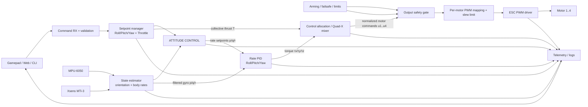

# Đặc tả kiến trúc điều khiển và kế hoạch sửa firmware ESP32

**Mục đích:** Giao cho người triển khai tái cấu trúc logic điều khiển chuyến bay theo sơ đồ đã thống nhất. Tài liệu này là đặc tả và kế hoạch kiểm thử; không phải mã nguồn và không cho phép bỏ qua khóa an toàn động cơ.

## 1. Mục tiêu và phạm vi

Hệ thống cần nhận bộ góc đặt `Roll_sp`, `Pitch_sp`, `Yaw_sp`; dùng góc ước lượng và tốc độ góc từ chuỗi cảm biến hiện có để điều khiển bốn motor sao cho drone bám và giữ các góc đặt. Web/gamepad là nguồn phát lệnh, ESP32 là nơi chạy vòng điều khiển thời gian thực. Web không tính PID hay tự tính PWM motor.

Phạm vi tái cấu trúc là đường đi lệnh, điều khiển tư thế, phân bổ motor, xuất PWM và telemetry. Giữ nguyên phần cứng và quy trình thu thập cảm biến trước khi có yêu cầu riêng:

| Phần phải giữ | Cấu hình hiện có trong firmware |
|---|---|
| MPU-6050 | I2C SDA GPIO 14, SCL GPIO 15 |
| Xsens MTi-3 | UART1 RX GPIO 2, TX GPIO 3, 115200 baud |
| Motor 1 | GPIO 7, Front-Right, CCW; ESC range 1000–2000 µs |
| Motor 2 | GPIO 6, Rear-Left, CCW; ESC range 1000–2000 µs |
| Motor 3 | GPIO 5, Front-Left, CW; ESC range 1000–2000 µs |
| Motor 4 | GPIO 4, Rear-Right, CW; ESC range 1000–2000 µs |
| Chu kỳ điều khiển danh định | 200 Hz, chu kỳ 5 ms |

Không thay đổi trình tự khởi tạo, hiệu chuẩn gyro, đảo trục Xsens, nguồn dự phòng MPU/Xsens hoặc cấu hình Wi-Fi/Serial trong cùng đợt tái cấu trúc bộ điều khiển. **Dải ESC đã được chốt: cả bốn ESC dùng chung 1000 µs min/disarm và 2000 µs max; xóa mọi cấu hình, ánh xạ, lệnh CLI, tài liệu và ví dụ cũ cho phép M3 hoặc motor bất kỳ dùng dải khác.**

## 2. Sơ đồ khối đề xuất

Trong sơ đồ tay, khối `ATT CONT` nên được hiểu là **cả hai vòng điều khiển tư thế**: vòng ngoài góc và vòng trong tốc độ góc. Các ngõ `U1..U4` nên được định nghĩa lại để tránh nhầm với bốn motor: chúng là bốn lệnh ảo của thân bay, gồm lực đẩy tổng `T` và ba moment `τroll`, `τpitch`, `τyaw`. Khối `Mix` nhận bốn đại lượng đó và tạo `u1..u4` cho bốn motor.

### Vai trò và nơi đặt PID

1. **Vòng ngoài góc (attitude):** so sánh góc đặt với góc ước lượng; tạo tốc độ góc đặt `p_sp, q_sp, r_sp`. Với Roll/Pitch có thể dùng P-controller; với Yaw phải xử lý sai số góc quấn vòng. Dùng quaternion cho phép tính lỗi tư thế là hướng ưu tiên của PX4; nếu triển khai Euler, phải xử lý wrap Yaw và giới hạn miền hoạt động.
2. **Vòng trong tốc độ (rate):** PID trên `rate_sp - gyro_filtered`, tạo moment Roll/Pitch/Yaw. Vòng này chạy nhanh hơn và được chạy ở chu kỳ điều khiển 200 Hz. Bộ tích phân có giới hạn/anti-windup; D-term phải lọc và không khuếch đại nhiễu gyro.
3. **Mixer/control allocation:** nằm sau các vòng PID, không ở trước PID. Mixer chuyển `T` và ba moment thành bốn motor theo hình học Quad-X; xử lý bão hòa để giữ quyền điều khiển Roll/Pitch khi có thể.
4. **PWM/ESC:** nhận lệnh motor đã được giới hạn, đổi lệnh chuẩn hóa sang dải pulse chung 1000–2000 µs cho cả bốn ESC, áp dụng slew limit và khóa an toàn. Không có hiệu chỉnh range riêng theo motor. Driver không tự tính PID hay nhận trực tiếp góc joystick.

Đây là cấu trúc điều khiển cascade và tách control allocation khỏi controller như tài liệu PX4 mô tả. Không sao chép mù hệ số PID, giới hạn, hoặc mixer PX4: chúng phụ thuộc động cơ, ESC, khung, đơn vị, chiều trục và phép đo thực tế.

## 3. Định nghĩa điều khiển “giữ đúng góc đặt”

### 3.1 Lệnh setpoint

- `Roll_sp`, `Pitch_sp`, `Yaw_sp` là góc mục tiêu tuyệt đối theo độ, dùng cùng hệ trục, chiều dương và datum với trạng thái ước lượng.
- `Throttle` là lệnh lực đẩy/ga tổng riêng. Nó không được suy ra từ Roll/Pitch/Yaw.
- Mất gói RC không được tự tạo setpoint mới từ số 0. Setpoint cuối cùng có thể được giữ trong khoảng failsafe được định nghĩa; sau timeout phải chuyển sang trạng thái failsafe rõ ràng.
- Khi chọn “giữ hướng hiện tại”, chụp Yaw hiện tại đúng một lần tại lúc chuyển mode/ARM và giữ giá trị đó. Không cập nhật Yaw_sp mỗi chu kỳ vì như vậy bộ điều khiển sẽ luôn đuổi theo góc hiện tại và không giữ hướng.
- Yaw sai số phải là sai số góc ngắn nhất, ví dụ đặt `179°`, đo `-179°` thì lỗi là `-2°`, không phải `358°`.

### 3.2 Vòng điều khiển góc

Đặt `e_att = attitude_error(attitude_sp, attitude_est)`. Vòng ngoài đổi lỗi tư thế thành `rate_sp`, giới hạn tốc độ góc theo cấu hình an toàn. Với đầu vào là Euler, các kênh Roll/Pitch/Yaw phải dùng đúng thứ tự mảng và quy ước độ; nếu đầu vào gyro là độ/giây thì đổi sang rad/giây đúng một lần tại ranh giới controller.

### 3.3 Vòng điều khiển rate

Với mỗi trục, PID so sánh `rate_sp` với gyro đã hiệu chuẩn/lọc trong frame thân máy bay. Đầu ra là moment chuẩn hóa có giới hạn. Thứ tự trục và dấu phải được xác nhận bằng thử nghiệm bàn nghiêng; không sửa dấu theo phỏng đoán dựa vào tên trục.

### 3.4 Mixer Quad-X và từng motor

Mixer nhận `[T, τroll, τpitch, τyaw]`, sau đó ánh xạ sang motor theo **đúng bố trí và chiều quay vật lý**. Biểu thức hiện tại trong `px4_pid.cpp` là cấu hình đang có trong source; người triển khai phải đối chiếu với khung thật, không tự xem comment là bằng chứng chiều motor đúng.

Giữ cấu hình chân đã nêu ở mục 1. Cả bốn ESC cùng dùng một dải: `0.0 -> 1000 µs`, `1.0 -> 2000 µs`; không có dải riêng, offset, ngoại lệ M3 hay remap theo motor. Xóa API cấu hình min/max/spin-min riêng từng motor và các lệnh CLI thay đổi các mốc này. Idle spin nếu dùng phải nằm trong cùng dải, không thay đổi min/max ESC.

## 4. Đối chiếu với source hiện tại

Đây là các điểm cần người triển khai xử lý; chưa được xem là đã sửa:

- `dual_imu_esp32c6.ino` hiện đọc MPU/Xsens trong vòng chính, cập nhật attitude, gọi `px4Controller.update()` theo mốc 5 ms, rồi cập nhật ESC và xử lý lệnh mạng/Serial. Giữ luồng cảm biến và chân, nhưng tách RX/parsing khỏi công việc nặng để không gây jitter cho vòng 200 Hz.
- Trong đường chạy hiện tại, khi có Xsens orientation, Roll/Pitch/Yaw lấy từ Xsens; gyro là phép trộn 85% Xsens và 15% MPU. Khi Xsens không có orientation, code dùng Roll/Pitch và gyro MPU; không có Yaw từ MPU. Bảo toàn hành vi này cho bản tái cấu trúc ban đầu, đồng thời ghi rõ trạng thái “yaw invalid” khi mất Xsens thay vì giả vờ Yaw được ước lượng tốt.
- Có các file `px4_ekf.*`, nhưng main loop hiện tại trong `.ino` đang tự gán `attitudeState` và không gọi `PX4_EKF::update()`. Không đổi sang EKF khác trong cùng đợt nếu yêu cầu là giữ nguyên xử lý cảm biến đang chạy. Xác minh chính xác firmware đang nạp và file `.ino` là entry point trước khi triển khai.
- `PX4_FlightController` hiện gom outer angle, inner rate PID và mixer trong `px4_pid.*`. Tách interface/logical responsibility thành controller → allocator → ESC output; có thể giữ class/file hiện tại tạm thời nếu tách được contract rõ ràng và không đổi phần cảm biến.
- `executeCommand()` nhận RC format `RC,<thr>,<roll>,<pitch>,<yaw>,<arm>`. Cần chốt hợp đồng thống nhất với web/Serial, xác thực đủ trường, giới hạn giá trị, loại NaN/Inf, xác nhận ARM bằng telemetry và xác định rõ đơn vị RC. Không chấp nhận gói lỗi như lệnh hợp lệ.
- `PX4_FlightController::update()` reset controller và xuất disarmed/idle nếu chưa ARM hoặc ga dưới 5%. Xem lại hành vi này trong thiết kế: khóa cứng khi disarmed là bắt buộc; còn khi armed, mức ga thấp có cho phép moment cân bằng hay không phải được định nghĩa riêng, tránh PID reset liên tục làm mất trạng thái.
- Current loop updates motor targets from controller only when armed and throttle >=2%; otherwise idle. Xung 900/disarmed là trạng thái khóa phần cứng, không phải mục tiêu để joystick thay đổi khi disarmed.
- Kiểm tra mọi nơi ghi PWM để không có CLI, test motor, failsafe hoặc telemetry task ghi đè đầu ra của allocator trong lúc PID hoạt động. Chỉ một output owner được phép commit motor target trong mỗi chu kỳ.

## 5. Hợp đồng module đề xuất

| Module | Input | Output | Quy tắc |
|---|---|---|---|
| Sensor acquisition | MPU I2C, Xsens UART | Mẫu có timestamp, validity | Giữ pin, parser, calibration và axis transform hiện có |
| State estimator/interface | Sensor samples | attitude, body rates, validity | Một nguồn state canonical; đơn vị/frame được ghi rõ |
| Command receiver | WebSocket/Serial | RC command validated | Không chạy PID ở task mạng; publish snapshot mới nhất/queue |
| Setpoint manager | RC command, mode, arm event | attitude_sp, thrust_sp | Giữ góc đặt đúng nghĩa; Yaw-hold chụp một lần |
| Attitude controller | attitude_sp, attitude_est | rate_sp | Outer loop; góc và wrap được kiểm thử |
| Rate controller | rate_sp, gyro_filtered | torque_sp | Inner PID; anti-windup/filter; đúng đơn vị |
| Allocator/mixer | thrust_sp, torque_sp, frame geometry | normalized motor commands | Quad-X geometry, saturation/desaturation |
| Safety/output supervisor | arm state, failsafe, allocator outputs | permitted motor commands | Disarmed luôn áp dụng pulse disarm; ARM có ACK/state thật |
| ESC output | permitted commands | GPIO PWM | Giữ GPIO 7/6/5/4, common 1000–2000 µs range, PWM rate và slew |
| Telemetry | snapshot các module | UI/log | Phân biệt setpoint, measured, PID torque, mixer target, actual PWM |

## 6. Yêu cầu thời gian thực và đồng bộ

- Vòng flight-control chạy định kỳ 200 Hz; tính `dt` từ timestamp thật và ghi jitter/overrun. Không đọc WebSocket, format chuỗi dài hay chờ Serial trong vòng này.
- Tác vụ truyền thông xác thực lệnh rồi cập nhật snapshot/queue thread-safe. Flight loop đọc một bản RC/setpoint nhất quán mỗi chu kỳ.
- Dữ liệu cảm biến có timestamp/validity. Khi cảm biến mất hoặc NaN/Inf, controller phải đi vào hành vi failsafe đã định nghĩa, không tiếp tục giữ giá trị rác.
- Telemetry rate không được làm nghẽn Serial hoặc trì hoãn PWM. Log chẩn đoán theo chu kỳ thưa, không in mỗi 200 Hz.
- Có watchdog RC riêng và watchdog output; phân biệt mất mạng, mất Xsens, mất MPU, lỗi estimator và emergency stop trong telemetry.

## 7. Kế hoạch chỉnh sửa cho người triển khai

1. **Chốt baseline:** xác nhận entry-point `.ino`, source đang nạp lên bo, board revision, dải pulse từng ESC, thứ tự motor, chiều quay và frame convention. Lưu commit/bản sao baseline.
2. **Lập bảng interface hiện trạng:** xác định nguồn RC, format, đơn vị, command rate; trạng thái ARM; estimator thực sự được gọi; mọi chỗ ghi PWM. Không chỉnh gain ở bước này.
3. **Bảo toàn cảm biến:** giữ `mpu6050.*`, `xsens_mti.*`, pin, parser, calibration, axis inversion và phép kết hợp state hiện hành. Bổ sung timestamp/validity chỉ ở interface cần thiết; không thay thuật toán sensor fusion nếu chưa có yêu cầu.
4. **Tách lệnh và setpoint:** chuẩn hóa một cấu trúc lệnh RC; kiểm tra bounds/finite; đồng bộ thread; tách angle setpoint, yaw hold và thrust setpoint. ARM/DISARM phải là state machine có ACK thật.
5. **Tách controller cascade:** outer attitude → rate setpoint; inner PID → torque. Chuẩn hóa đơn vị/frame; xử lý Yaw wrap; reset/anti-windup có chủ đích khi mode hoặc arm đổi.
6. **Tách allocator khỏi controller:** mixer chỉ nhận thrust/moment và geometry; xuất lệnh motor chuẩn hóa; saturation/desaturation có kiểm soát.
7. **Tách PWM mapping:** chuyển lệnh chuẩn hóa sang dải chung 1000–2000 µs cho cả bốn motor; xóa API/lệnh cấu hình range riêng. Giữ GPIO, tần số và slew limiter đang cấu hình. Safety gate là lớp cuối ngay trước ESC driver.
8. **Telemetry:** phát các trường setpoint, estimate, rate setpoint, gyro filtered, torque, motor normalized target, PWM target/current, mode, arm state và failsafe. Không gọi tất cả là “PWM” nếu là target nội bộ.
9. **Kiểm thử theo tầng** theo mục 8. Chỉ sau khi logic, dấu điều khiển, dải PWM và failsafe qua bench mới được tiến tới thử nghiệm có cánh quạt trong môi trường kiểm soát.

## 8. Kịch bản kiểm thử và tiêu chí đạt

### A. Kiểm thử offline/host cho toán học

1. **Sai số Yaw wrap:** đặt/đo `179°/-179°`; controller chọn đường ngắn 2°, không tạo lệnh gần 360°.
2. **Giữ góc:** target bằng actual cho rate setpoint gần 0; lệch góc dương và âm tạo rate setpoint đúng dấu, bị giới hạn.
3. **Rate PID:** rate đo bằng setpoint làm giảm proportional error; thay đổi measurement không tạo setpoint kick lớn; integral nằm trong giới hạn.
4. **Mixer dấu/geometry:** kiểm tra riêng một moment Roll/Pitch/Yaw tại ga giữa để chứng minh đúng motor pair tăng/giảm theo sơ đồ khung thật. Không chấp nhận chỉ dựa trên tên M1..M4.
5. **Saturation:** đầu vào cực trị không tạo NaN/Inf hoặc vượt normalized min/max; ưu tiên bảo toàn Roll/Pitch khi allocator phải giảm quyền điều khiển.
6. **PWM mapping:** cùng một phép ánh xạ cho mọi motor: normalized 0/1 tương ứng 1000/2000 µs; không tồn tại ngoại lệ hoặc tham số range theo motor.

### B. Kiểm thử cảm biến và setpoint trên bàn, motor chưa ARM

1. Khởi động bằng cánh quạt đã tháo. Xác nhận MPU/Xsens giữ nguyên pin, trạng thái ready, góc ổn định và frame convention.
2. Gửi lệnh đặt góc nhỏ, ví dụ Roll `+5°`, Pitch `-5°`, Yaw `+10°`; telemetry phải cho thấy setpoint nhận đúng, không bị ghi đè bằng góc đo.
3. Xoay tay khung quanh từng trục; estimator đổi theo hướng dự kiến. Xác nhận trục/chiều trước khi bật motor.
4. Khi disarmed, dù setpoint/joystick đổi, ESC output phải ở pulse disarm; telemetry vẫn được phép hiển thị motor preview riêng nhưng không được ghi preview xuống GPIO.

### C. Kiểm thử output/ESC trên bench, cánh quạt tháo

1. ARM chỉ qua quy trình xác nhận; UI chỉ báo ARMED khi telemetry từ ESP xác nhận.
2. Kiểm tra xung idle/min của từng output và thứ tự GPIO 7, 6, 5, 4 bằng máy hiện sóng/logic analyzer hoặc thiết bị đo phù hợp.
3. Kiểm tra pulse từng motor: disarm/min 1000 µs và max 2000 µs trên cả bốn kênh; xác nhận cùng tần số PWM và output 0–3 ứng với đúng motor vật lý.
4. DISARM, RC timeout, sensor invalid và emergency stop phải đưa output về trạng thái an toàn đã cấu hình; không được hồi ARM tự động.
5. Motor test riêng lẻ chỉ được kích hoạt bằng command test tường minh, timeout tự kết thúc; kiểm tra không có task khác ghi đè.

### D. Kiểm thử đóng vòng cơ khí không cánh quạt

1. Giữ drone cố định an toàn, ARM ở chế độ bench được phép, thrust thấp theo quy trình thử nghiệm.
2. Nghiêng khung nhẹ từng trục; mixer phải tăng lực ở phía tạo moment phục hồi. Nếu hướng sai, dừng, sửa frame/sign mapping rồi lặp lại; không thử bay để “xem có tự cân bằng không”.
3. Kiểm tra target step nhỏ: Roll/Pitch đổi setpoint và rate setpoint đổi đúng chiều; Yaw step qua ±180° chọn đường ngắn.
4. Kiểm tra khi thả joystick: Roll/Pitch trở về góc đặt đã định nghĩa; Yaw tiếp tục giữ target/heading, không tự trôi vì setpoint bị cập nhật theo measurement.

### E. Kiểm thử bay có kiểm soát

Chỉ thực hiện sau khi các tầng A–D đạt, có người phụ trách an toàn và kill switch hoạt động. Bắt đầu với chế độ ổn định, góc đặt nhỏ và vùng thử được kiểm soát. Ghi log setpoint/response/torque/motor. Tuning theo thứ tự **rate loop trước, attitude loop sau**; không đổi nhiều gain cùng lúc. Tiêu chí bám góc định lượng và điều kiện bay phải được đội dự án chốt trước thử nghiệm; không tự coi con số mặc định PX4 là đạt cho airframe này.

### Điều kiện nghiệm thu tối thiểu

- Kênh điều khiển RC đổi được setpoint trên ESP, telemetry chỉ rõ giá trị đã nhận.
- Khi ARM hợp lệ và ga đủ điều kiện, controller tạo rate/torque và mixer tạo motor target khác nhau khi có sai lệch hoặc lệnh setpoint.
- Khi góc đặt bằng trạng thái đo, rate setpoint tiến về 0; khi có nhiễu/độ lệch, moment điều khiển có dấu phục hồi đã xác minh.
- Actual PWM telemetry theo được target qua slew limiter, trong đúng dải từng ESC.
- DISARM, emergency stop, mất RC và sensor invalid luôn có kết quả rõ ràng, kiểm thử được; không bao giờ cần bỏ qua safety gate để xem mixer phản ứng.

## 9. Tài liệu tham khảo

- PX4, [Controller Diagrams](https://docs.px4.io/main/en/flight_stack/controller_diagrams): kiến trúc cascade, attitude/rate loops, estimator và pipeline IMU.
- PX4, [Control Allocation (Mixing)](https://docs.px4.io/v1.13/en/concept/control_allocation): tách controller khỏi geometry-specific motor allocation/output.
- PX4, [Multicopter PID Tuning Guide](https://docs.px4.io/v1.12/en/config_mc/pid_tuning_guide_multicopter_basic): tuning theo thứ tự rate trước attitude sau, quan sát setpoint và response, kiểm tra propeller-off trên bench.

Các tài liệu PX4 dùng làm tham khảo kiến trúc và quy trình, không phải chứng nhận hệ thống ESP32 này tương đương PX4 hoặc sẵn sàng bay.
