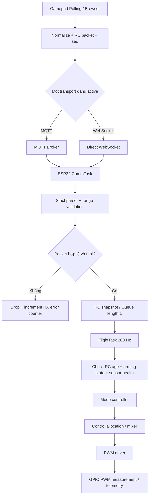
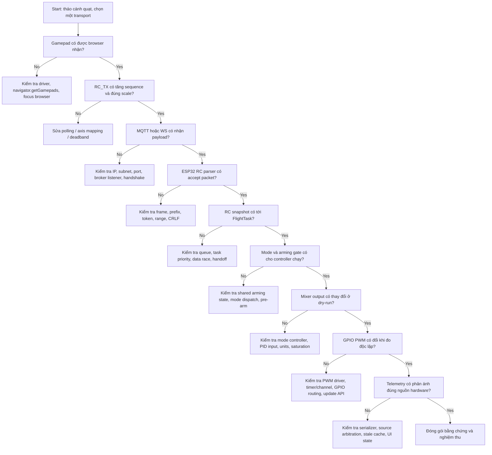

# PHẢN BIỆN KỸ THUẬT & HƯỚNG DẪN XÁC MINH
## Sự cố đường ống điều khiển analog Xbox 360 → Web GCS → MQTT/WebSocket → ESP32-C6 → PWM

- **Dự án:** UAV Real-Time Flight Controller – ESP32-C6
- **Tài liệu được phản biện:** `ANALOG_RC_PIPELINE_DEBUG_REPORT.md`
- **Ngày rà soát:** 09/11/2026
- **Phạm vi:** Kiểm tra tính hợp lý của RCA, mã giả, kiến trúc truyền lệnh, cách chứng minh kết quả và quy trình xác minh.
- **Giới hạn:** Chỉ có báo cáo mô tả, chưa có 25 tệp mã nguồn, log thô, packet capture, bản build `.bin` hoặc ảnh oscilloscope. Vì vậy, đây là phản biện thiết kế và bằng chứng được nêu trong báo cáo, không phải xác nhận commit hay nghiệm thu phần cứng.

---

# 1. KẾT LUẬN ĐIỀU HÀNH

**Chưa đủ căn cứ để kết luận sự cố đã được khắc phục và nghiệm thu thành công.** Báo cáo đưa ra một số hướng sửa có giá trị, nhưng một số nguyên nhân gốc rễ đang được khẳng định quá mức; một số giải pháp có lỗi logic hoặc chưa có bằng chứng đo kiểm.

## 1.1. Những điểm có cơ sở

1. Hai địa chỉ `10.11.162.171` và `10.11.153.160`, nếu cùng dùng subnet mask `255.255.248.0` (`/21`), thuộc hai subnet khác nhau. Điều này có thể làm mất kết nối trực tiếp tới broker nếu không có định tuyến phù hợp.
2. Cần có parser RC kiểm tra cấu trúc và miền giá trị trước khi cập nhật lệnh điều khiển.
3. Cần kiểm tra cả nhánh MQTT, nhánh WebSocket, RC input manager, FlightTask, mixer và driver PWM; chỉ kiểm tra giao diện Gamepad là chưa đủ.
4. Cần có build ID/firmware version hiển thị khi khởi động để xác định chính xác firmware đang chạy.
5. Cần có test harness kiểm tra độc lập từng chặng của data pipeline.

## 1.2. Những kết luận chưa được chứng minh hoặc có dấu hiệu sai

| Khẳng định trong báo cáo | Phản biện | Trạng thái |
|---|---|---|
| `newlib-nano` trên ESP32-C6 luôn tắt `%f` của `sscanf` | Không thể kết luận chung như vậy. Tài liệu ESP-IDF cho ESP32-C6 nêu chip này có bản `printf/scanf` định dạng đầy đủ trong ROM; cần kiểm thử đúng core/toolchain đang dùng. | Chưa chứng minh |
| `String::toFloat()` độc lập hoàn toàn với runtime C | Không đúng với mã nguồn Arduino-ESP32 hiện tại: `String::toFloat()` gọi `atof()`. | Sai về diễn giải |
| Parser mới bảo đảm dữ liệu hợp lệ | `toFloat()` trả về 0 khi chuyển đổi thất bại; đoạn mã chưa kiểm tra `NaN`, `Inf`, miền giá trị, trường rỗng hoặc token thừa. | Chưa an toàn |
| `No changed sectors found` chứng minh IDE không biên dịch lại | Không đúng. Esptool có thể so sánh ảnh và xác minh MD5; thông báo này chỉ nói vùng flash tương ứng đã giống ảnh đang nạp. | Sai về suy luận |
| Chèn `__TIME__` sẽ phá cache triệt để | `__TIME__` chỉ thay đổi khi translation unit được biên dịch lại và thời điểm biên dịch khác giây; nó không buộc build system biên dịch lại file nguồn. | Không phải cách sửa gốc |
| `window.location.hostname` tự tìm đúng broker | Nó chỉ là hostname của trang đang mở. Với `file://`, hostname thường rỗng; fallback `127.0.0.1` trỏ về máy chạy trình duyệt, không mặc nhiên là broker. | Có điều kiện |
| MQTT và WebSocket đồng thời gửi RC tạo dự phòng an toàn | Có nguy cơ nhận lệnh trùng, lệnh đến lệch thứ tự và hai nguồn ghi đè cùng biến RC nếu không có arbitration/sequence. | Thiết kế thiếu |
| `1077 µs` chứng minh từng nhận được `2.84%` RC | Chỉ đúng nếu giá trị PWM chắc chắn đến từ đúng công thức, đúng mode, đúng nguồn hardware và đúng thời điểm. Một giá trị UI đơn lẻ không chứng minh được điều đó. | Suy luận không đủ |
| Đẩy ga 98% cho ra 1981 µs trong mọi mode | Công thức đó chỉ có thể áp dụng cho nhánh Direct Manual đã mô tả. Altitude Hold không nên ánh xạ trực tiếp throttle thành PWM như vậy. | Sai nếu áp dụng cho mọi mode |
| Độ trễ `< 8 ms` và parser `< 5 µs` đã PASS | Báo cáo không cung cấp cách đo, log timestamp, số mẫu, percentiles, điều kiện mạng hoặc phép đo GPIO. | Chưa có bằng chứng |

## 1.3. Quyết định kỹ thuật đề xuất

- **Không tăng gain PID, không thay đổi mixer và không ép PWM lên cao để chẩn đoán lỗi RC.**
- Trước tiên chứng minh chuỗi `Gamepad → RC_TX → Broker/WS → RC_RX → RC snapshot → FlightTask`.
- Tách chẩn đoán dữ liệu RC khỏi việc điều khiển ESC. Khi kiểm tra parser và mixer, ưu tiên chế độ dry-run; tháo cánh quạt nếu cần đo tín hiệu PWM với ESC.
- Chỉ công nhận PASS khi có log có sequence/timestamp và phép đo độc lập ở GPIO PWM.

---

# 2. PHẢN BIỆN CHI TIẾT ROOT CAUSE ANALYSIS

## 2.1. RCA 1 – `sscanf("%f")` và newlib-nano

### Điều báo cáo đang khẳng định

Báo cáo cho rằng ESP32-C6 dùng RISC-V 32-bit và `newlib-nano` mặc định tắt hỗ trợ số thực của `scanf`, khiến `sscanf(..., "%f", ...)` luôn trả về 0.

### Phản biện

Không thể suy ra việc `%f` thất bại chỉ từ hai thông tin “RISC-V” và “newlib-nano”. Đây là vấn đề phụ thuộc phiên bản ESP-IDF, Arduino-ESP32 core, cấu hình libc, ROM implementation và linker. Tài liệu ESP-IDF v5.2.6 cho ESP32-C6 nêu rằng chip ESP32-C6 có bản định dạng đầy đủ của `printf/scanf` trong ROM; tài liệu cũng mô tả giới hạn Nano Format chủ yếu liên quan định dạng số nguyên 64-bit và một số đặc tả C99. Hướng dẫn Arduino-ESP32 hiện hành mô tả Nano Format hỗ trợ các specifier C89. Vì `%f` là specifier chuẩn C, không có căn cứ để khẳng định mọi build ESP32-C6 đều tắt `%f`.

**Kết luận:** `sscanf` có thể đã thất bại trong build cụ thể, nhưng nguyên nhân “newlib-nano mặc định tắt `%f` trên ESP32-C6” chưa được chứng minh và có thể sai với cấu hình đang dùng.

### Cách xác minh bắt buộc

Tạo một sketch kiểm thử độc lập, không kết nối ESC:

```cpp
#include <Arduino.h>
#include <stdio.h>

void setup() {
    Serial.begin(115200);
    delay(1000);

    const char *src = "98.0,0.0,0.0,22.0";
    float t = -1.0f, r = -1.0f, p = -1.0f, y = -1.0f;

    const int parsed = sscanf(src, "%f,%f,%f,%f", &t, &r, &p, &y);

    Serial.print("parsed = ");
    Serial.println(parsed);
    Serial.print("t = "); Serial.println(t, 3);
    Serial.print("r = "); Serial.println(r, 3);
    Serial.print("p = "); Serial.println(p, 3);
    Serial.print("y = "); Serial.println(y, 3);
}

void loop() {}
```

Kết quả mong đợi nếu parser hoạt động: `parsed = 4`, các giá trị lần lượt `98`, `0`, `0`, `22`.

- Ghi lại phiên bản Arduino IDE, Arduino-ESP32 core, board FQBN và toolchain.
- Bật verbose compile và lưu linker command/configuration.
- Không dùng `Serial.printf("%f")` làm bằng chứng duy nhất; in bằng `Serial.print(value, 3)` để tránh nhầm lỗi format output với lỗi `sscanf` input.
- Chạy test với chuỗi có CRLF, token rỗng, thiếu trường, trường thừa và ký tự không phải số.

### Đánh giá phương án thay bằng `String::toFloat()`

Phương án delimiter parser tốt hơn ở chỗ kiểm tra được số dấu phẩy và vị trí trường. Tuy nhiên, nhận định “độc lập hoàn toàn với runtime C” là không đúng: mã nguồn Arduino-ESP32 hiện tại triển khai `String::toFloat()` bằng `atof()`.

Ngoài ra, `toFloat()` trả về `0` khi chuỗi không chuyển đổi được. Vì vậy các đầu vào sau có thể khó phân biệt nếu chỉ nhìn giá trị kết quả:

- `0`
- chuỗi rỗng
- `abc`
- token lỗi

Đoạn mã hiện tại cũng chưa kiểm tra:

- Đúng chính xác 4 trường số hay không.
- `NaN`, `Inf`, số quá lớn.
- Throttle trong `[0,100]`.
- Roll/Pitch/Yaw trong miền giao thức quy định.
- Token rỗng hoặc chuỗi có thêm dấu phẩy.
- Packet quá dài.

**Khuyến nghị:** dùng bộ phân tích có giới hạn kích thước, kiểm tra toàn bộ token, kiểm tra `isfinite()` và miền giá trị. Có thể dùng `strtof()` với `endptr`/`errno` nếu toolchain hỗ trợ; không dùng `toFloat()` như một validator.

---

## 2.2. RCA 2 – Arduino IDE Build Cache và `No changed sectors found`

### Điều báo cáo đang khẳng định

Báo cáo diễn giải thông báo `No changed sectors found` thành bằng chứng 100% IDE không biên dịch lại và ESP32 vẫn chạy firmware cũ.

### Phản biện

Thông báo của esptool được phát ra trong quá trình so sánh nội dung ảnh firmware với flash. Nếu không có vùng dữ liệu khác biệt, esptool có thể đọc/đối chiếu MD5 và xác nhận ảnh đầu vào đã có trong flash. Điều đó **không chứng minh** IDE không biên dịch lại. Nó chỉ cho thấy image được đưa tới bước nạp giống nội dung hiện có tại vùng địa chỉ đó.

Một build mới vẫn có thể tạo ra binary giống hệt binary cũ nếu thay đổi không ảnh hưởng đến image, file nguồn thực tế không nằm trong target build, hoặc thay đổi chưa được lưu. Ngược lại, nếu binary khác thì esptool thường sẽ ghi các vùng khác biệt.

### Phản biện `__TIME__`

Chèn `__DATE__`/`__TIME__` giúp in thời điểm compile và có thể làm binary thay đổi khi file chứa macro được biên dịch lại ở thời điểm khác. Nhưng:

- Không đảm bảo file `.cpp` trong thư mục con được biên dịch lại.
- Không giải quyết lỗi cấu hình source path hoặc project build graph.
- Hai lần build trong cùng một giây có thể có cùng `__TIME__`.
- Làm binary không tái lập (non-reproducible), gây nhiễu so sánh image.

### Cách xác minh đúng

1. Lưu log verbose compile và xác nhận `wifi_control.cpp` cùng các source cần sửa xuất hiện trong lệnh biên dịch.
2. Dùng clean build bằng Arduino IDE/Arduino CLI; không dựa vào `__TIME__` để ép cache.
3. So sánh SHA-256 của binary trước/sau build.
4. Nạp đúng binary vừa tạo, ghi lại port, FQBN, địa chỉ flash và log esptool.
5. Firmware in `FW_VERSION`, `GIT_COMMIT` hoặc `BUILD_ID` ngay khi boot.
6. Xác minh firmware runtime khớp build vừa nạp.

Ví dụ lệnh kiểm tra Git tại máy phát triển:

```bash
git fetch origin
git checkout base
git show --stat --oneline 507719d
git show --format=fuller --no-ext-diff 507719d -- \
  firmware/dual_imu_esp32c6/src/comm/wifi_control.cpp \
  firmware/dual_imu_esp32c6/src/supervisor/serial_command_interpreter.cpp \
  firmware/dual_imu_esp32c6/dual_imu_esp32c6.ino \
  tools/web_simulator/imu_3d_simulator.html
```

Nếu commit chưa có ở local:

```bash
git cat-file -e 507719d^{commit}
```

Lưu ý: commit `507719d` chưa được xác minh độc lập trong lần rà soát này; cần đối chiếu `git show` và build artifact thực tế.

---

## 2.3. RCA 3 – IP/subnet MQTT Broker

### Tính toán subnet

Với subnet mask `255.255.248.0` (`/21`):

- `10.11.162.171` thuộc network `10.11.160.0/21`.
- `10.11.153.160` thuộc network `10.11.152.0/21`.

Hai địa chỉ thuộc hai subnet khác nhau. Vì vậy, giả thuyết IP broker cũ gây lỗi kết nối là hợp lý **nếu mạng không có route giữa hai subnet hoặc firewall chặn traffic**. Khác subnet không tự động đồng nghĩa không thể kết nối; router có thể định tuyến được.

### Mâu thuẫn trong giải pháp “tự động đồng bộ IP”

Báo cáo đưa ra URL:

```javascript
mqttBrokerUrl: `ws://${window.location.hostname || '127.0.0.1'}:9001`
```

nhưng lại gửi IP cố định:

```javascript
sendHardwarePacket('MQTT,10.11.153.160,1883\\n');
```

Đây chưa phải tự động đồng bộ IP vì IP gửi xuống ESP32 vẫn hard-code.

`window.location.hostname` là hostname nơi trang GCS được phục vụ, không nhất thiết là MQTT broker. Nếu mở file bằng `file://`, hostname có thể rỗng và fallback `127.0.0.1` trỏ về chính máy chạy trình duyệt.

### Khuyến nghị

Chọn một trong các cách sau:

1. **DHCP reservation/static IP:** cố định IP cho broker trong mạng lab; đơn giản và dễ nghiệm thu.
2. **DNS/mDNS:** ESP32 kết nối theo hostname broker đã cấu hình; kiểm tra router và thư viện có hỗ trợ.
3. **Cấu hình qua GCS:** cho phép người vận hành nhập broker host/port, kiểm tra hợp lệ rồi gửi xuống ESP32 qua kênh quản trị đã xác thực.
4. **Trang GCS được host cùng máy broker:** chỉ suy ra broker từ `window.location.hostname` khi kiến trúc triển khai cam kết web server và broker cùng host.

Không nên gửi một IP hard-code từ JavaScript rồi gọi đó là dynamic discovery.

### Lệnh kiểm tra Windows

```powershell
ipconfig
route print
ping 10.11.153.160
Test-NetConnection 10.11.153.160 -Port 1883
Test-NetConnection 10.11.153.160 -Port 9001
```

Diễn giải:

- `ping` thất bại không đủ kết luận port TCP không hoạt động; ICMP có thể bị chặn.
- TCP 1883 thường dành cho MQTT native TCP khi broker cấu hình listener đó.
- TCP 9001 chỉ dùng cho MQTT over WebSocket nếu broker được cấu hình listener WebSocket tương ứng; số port này không tự động có hiệu lực chỉ vì phía trình duyệt dùng nó.
- Kiểm tra firewall, listener và log broker.

---

# 3. PHẢN BIỆN KIẾN TRÚC MQTT + WEBSOCKET SONG SONG

## 3.1. Rủi ro lớn nhất: cùng một lệnh RC đi theo hai đường

Sơ đồ trong báo cáo thể hiện Browser publish tới MQTT Broker, đồng thời gửi trực tiếp WebSocket tới ESP32. Nếu cả hai đường cùng cập nhật `rcThrottle_`, `rcRoll_`, `rcPitch_`, `rcYaw_`, hệ thống có thể gặp:

- Một lệnh bị xử lý hai lần.
- Gói cũ từ đường chậm đến sau và ghi đè gói mới.
- MQTT QoS 1 có thể giao lại packet; ứng dụng phải chịu được duplicate.
- Một đường đang lỗi nhưng đường còn lại vẫn cập nhật, làm log khó xác định nguồn dữ liệu.
- Hai task cùng ghi một bộ biến RC mà không có snapshot đồng bộ.

**Hai đường truyền song song không tự động tạo thành redundancy an toàn.** Cần có cơ chế chọn nguồn, deduplicate, timeout và failover rõ ràng.

## 3.2. Kiến trúc khuyến nghị cho giai đoạn chẩn đoán

Chọn **một đường RC duy nhất** để loại bỏ biến số:

- Phương án A: Browser → MQTT over WebSocket → Broker → ESP32 MQTT/TCP → RC queue.
- Phương án B: Browser → WebSocket trực tiếp → ESP32 → RC queue.

Trong lúc debug, không publish cùng một RC packet qua cả A và B. Có thể giữ kênh còn lại cho telemetry/configuration, nhưng phải phân tách topic và vai trò.

## 3.3. Nếu bắt buộc giữ hai đường để dự phòng

Envelope của packet cần có ít nhất:

- `source`: `MQTT` hoặc `WS`.
- `session_id`: nhận diện phiên điều khiển.
- `seq`: số thứ tự tăng đơn điệu trong phiên.
- `sent_ms` hoặc timestamp phù hợp.
- `ttl_ms`: thời hạn lệnh.
- Các kênh RC.

ESP32 cần một RC Source Arbiter:

1. Chọn nguồn active theo cấu hình/ưu tiên.
2. Chấp nhận sequence mới hơn; bỏ packet duplicate hoặc cũ.
3. Không trộn từng trục từ hai nguồn.
4. Chỉ failover sau timeout đã định nghĩa và điều kiện nguồn dự phòng hợp lệ.
5. Ghi log nguồn đang active và lý do chuyển nguồn.

---

# 4. PHẢN BIỆN DELIMITER PARSER HIỆN TẠI

Đoạn mã trong báo cáo:

```cpp
float t = cmd.substring(startIdx, c1).toFloat();
float r = cmd.substring(c1 + 1, c2).toFloat();
float p = cmd.substring(c2 + 1, c3).toFloat();
float y = cmd.substring(c3 + 1).toFloat();

lastRcPacketMs_ = millis();
esc.feedWatchdog();
manager.setRcChannels(t, r, p, y);
```

## 4.1. Các lỗ hổng

- `toFloat()` không báo rõ conversion failure; chuỗi không hợp lệ có thể thành 0.
- Chỉ kiểm tra ba dấu phẩy, chưa chắc payload có đúng bốn token.
- Không chặn `NaN`, `Inf`, số ngoài miền hoặc chuỗi quá dài.
- Chưa xác nhận `RC,` bắt buộc hay cho phép parse cả chuỗi không có prefix.
- `String::substring()` tạo đối tượng String; dùng liên tục trong đường RC có thể gây cấp phát heap không cần thiết.
- `esc.feedWatchdog()` đang bị gắn với việc nhận packet; packet hợp lệ ở tầng parser không chứng minh FlightTask đã chạy thành công.
- Chưa có sequence để phát hiện packet cũ/trùng.
- Chưa có snapshot nguyên tử cho bốn trục RC.

## 4.2. Parser mẫu có kiểm tra

Đây là mẫu tham khảo cho giao thức `RC,throttle,roll,pitch,yaw`. Miền `throttle=[0,100]` và `roll/pitch/yaw=[-100,100]` chỉ áp dụng nếu GCS thống nhất dùng đơn vị phần trăm chuẩn hóa. Nếu firmware đang dùng miền khác, phải sửa contract trước khi dùng.

```cpp
#include <Arduino.h>
#include <stdlib.h>
#include <errno.h>
#include <math.h>
#include <string.h>

struct RcChannels {
    float throttlePct;
    float rollPct;
    float pitchPct;
    float yawPct;
};

static bool parseFloatToken(const char *&cursor,
                            const char *end,
                            float &value) {
    while (cursor < end && (*cursor == ' ' || *cursor == '\t')) {
        ++cursor;
    }

    if (cursor >= end) {
        return false;
    }

    errno = 0;
    char *next = nullptr;
    const float parsed = strtof(cursor, &next);

    if (next == cursor || next > end || errno == ERANGE || !isfinite(parsed)) {
        return false;
    }

    cursor = next;
    while (cursor < end && (*cursor == ' ' || *cursor == '\t')) {
        ++cursor;
    }

    value = parsed;
    return true;
}

static bool parseRcLine(const char *data,
                        size_t length,
                        RcChannels &out) {
    constexpr size_t MAX_PACKET = 96;
    if (data == nullptr || length == 0 || length >= MAX_PACKET) {
        return false;
    }

    char buffer[MAX_PACKET];
    memcpy(buffer, data, length);
    buffer[length] = '\0';

    // Cho phép CR/LF ở cuối dòng, không cho phép ký tự thừa sau token cuối.
    while (length > 0 &&
           (buffer[length - 1] == '\r' || buffer[length - 1] == '\n')) {
        buffer[--length] = '\0';
    }

    if (length < 3 || strncmp(buffer, "RC,", 3) != 0) {
        return false;
    }

    const char *cursor = buffer + 3;
    const char *end = buffer + length;
    RcChannels candidate{};
    float *fields[] = {
        &candidate.throttlePct,
        &candidate.rollPct,
        &candidate.pitchPct,
        &candidate.yawPct
    };

    for (int i = 0; i < 4; ++i) {
        if (!parseFloatToken(cursor, end, *fields[i])) {
            return false;
        }

        if (i < 3) {
            if (cursor >= end || *cursor != ',') {
                return false;
            }
            ++cursor;
        } else if (cursor != end) {
            return false; // Có token hoặc ký tự thừa.
        }
    }

    // Chỉ dùng các miền này nếu giao thức GCS quy định percent normalized.
    if (candidate.throttlePct < 0.0f || candidate.throttlePct > 100.0f) {
        return false;
    }
    if (fabsf(candidate.rollPct) > 100.0f ||
        fabsf(candidate.pitchPct) > 100.0f ||
        fabsf(candidate.yawPct) > 100.0f) {
        return false;
    }

    out = candidate; // Chỉ cập nhật output sau khi toàn bộ packet hợp lệ.
    return true;
}
```

**Chú ý:** `strtof()` vẫn là hàm thư viện C, nhưng không sử dụng nhánh format parsing của `scanf`. Cần build/test trên đúng toolchain. Nếu muốn parser hoàn toàn tự quản lý chuyển đổi số, có thể viết parser decimal cố định, nhưng phải kiểm thử kỹ dấu, phần thập phân và overflow.

## 4.3. Cập nhật watchdog đúng tầng

Không feed ESC watchdog chỉ vì CommTask nhận được một dòng RC. Nên tách ít nhất ba mốc:

- `lastValidRcMs`: thời điểm nhận packet RC đã parse và validate.
- `lastControlCycleMs`: thời điểm FlightTask hoàn tất vòng điều khiển hợp lệ.
- `lastPwmUpdateMs`: thời điểm PWM driver cập nhật đầu ra.

Chỉ watchdog của FlightTask mới được feed sau khi vòng điều khiển hoàn thành đúng điều kiện. RC timeout được FlightTask đọc để kích hoạt failsafe theo thiết kế. Không để một stream packet lỗi liên tục giữ watchdog “sống”.

---

# 5. ĐỒNG BỘ COMM TASK VÀ FLIGHT TASK

Báo cáo nêu CommTask 40 Hz và FlightTask 200 Hz. Đây là phân chia hợp lý về mặt chức năng, nhưng chưa mô tả cách truyền dữ liệu an toàn giữa hai task.

Không nên để CommTask ghi riêng lẻ bốn biến float trong khi FlightTask đọc cùng lúc. FlightTask có thể lấy throttle ở packet mới nhưng roll/pitch/yaw từ packet cũ.

## 5.1. Kiến trúc đề xuất



## 5.2. Cơ chế truyền snapshot

Dùng FreeRTOS queue chiều dài 1 với overwrite hoặc cơ chế snapshot có khóa ngắn. Với RC điều khiển thời gian thực, thường ưu tiên **giá trị hợp lệ mới nhất** hơn là xử lý một hàng dài các lệnh cũ.

Ví dụ cấu trúc dữ liệu:

```cpp
struct RcPacket {
    RcChannels channels;
    uint32_t sequence;
    uint32_t receivedAtMs;
    uint8_t source; // 0=MQTT, 1=WebSocket
};
```

CommTask chỉ parse, validate và publish snapshot. FlightTask lấy một snapshot hoàn chỉnh, kiểm tra tuổi dữ liệu và quyết định có sử dụng hay không.

---

# 6. PHẢN BIỆN PHÉP TÍNH PWM VÀ HAI CHẾ ĐỘ BAY

## 6.1. Phép tính `1050 + 98 × 9.5 = 1981 µs`

Phép tính số học là đúng. Nhưng ý nghĩa chỉ đúng nếu:

1. `t` là throttle phần trăm `[0,100]`.
2. Đang chạy đúng nhánh Direct Manual sử dụng công thức đó.
3. 1050 µs và 2000 µs là miền tín hiệu đã cấu hình/hiệu chuẩn phù hợp ESC.
4. Đầu ra không bị mixer, saturation, arming gate hoặc failsafe thay đổi.
5. Con số hiển thị đến từ telemetry phần cứng chứ không phải biến preview/simulation.

Không được áp dụng công thức này cho mọi chế độ bay.

## 6.2. Direct Manual khác Altitude Hold

| Chế độ | Ý nghĩa stick ga | Mong đợi đầu ra |
|---|---|---|
| Direct Manual | Có thể ánh xạ trực tiếp tới throttle/thrust command theo định nghĩa firmware | Thrust base đổi theo stick; mixer phân phối bốn motor |
| Altitude Hold | Stick thường tạo lệnh vận tốc lên/xuống; vùng giữa giữ mục tiêu độ cao | PWM phụ thuộc sai số độ cao, vận tốc đứng, tilt compensation và PID; không ánh xạ tuyến tính trực tiếp từ stick tới PWM |

Nếu dashboard đang chọn `Altitude Hold (Cascaded PID)`, không được kỳ vọng gạt throttle lên 98% sẽ tạo đúng `1981 µs` theo công thức Direct Manual. Đây là test sai mode.

Báo cáo cần ghi rõ test 98% được thực hiện ở mode nào. Nếu muốn kiểm tra parser, hãy kiểm tra `rcThrottle` đã nhận là 98.0. Không cần làm động cơ tăng tốc tới gần full throttle để chứng minh parser.

## 6.3. Số `1077 µs` không chứng minh packet 2.84%

Từ công thức đã nêu, nếu đúng là Direct Manual:

`(1077 - 1050) / 9.5 ≈ 2.84%`.

Nhưng phép đảo công thức chỉ cho biết **một giá trị đầu ra tương đương** 2.84% trong giả thiết ấy. Nó không chứng minh:

- packet 2.84% đã đến ESP32;
- packet đó mới và hợp lệ;
- giá trị không đến từ simulator;
- công thức đó là nguồn duy nhất tạo PWM;
- dữ liệu không phải telemetry cũ.

Muốn chứng minh phải log đồng thời `RC_RX seq`, `rcThrottle_`, `mode`, `source`, `PWM command` và đo GPIO PWM.

---

# 7. PHẢN BIỆN BENCHMARK VÀ CLAIM “PASS”

## 7.1. 40 Hz không tự chứng minh latency < 8 ms

40 Hz tương ứng chu kỳ gửi danh định 25 ms. Một packet có thể có latency dưới 8 ms trong mạng LAN, nhưng tần số gửi không chứng minh được latency đó.

Báo cáo cần cung cấp:

- Điểm bắt đầu đo: thời điểm đọc Gamepad hay thời điểm gọi publish.
- Điểm kết thúc: CommTask nhận, FlightTask dùng hay GPIO PWM đổi.
- Cách đồng bộ clock nếu đo một chiều qua nhiều thiết bị.
- Số lượng mẫu, thời lượng test và điều kiện Wi-Fi.
- `p50`, `p95`, `p99`, maximum, packet loss và jitter.

Không ghi `< 8 ms PASS` nếu chỉ biết gửi 40 packet mỗi giây.

## 7.2. Parser `< 5 µs` chưa có phép đo

Không thể suy ra thời gian parse từ việc chuỗi ngắn hay từ tần số 40 Hz. Đo riêng bằng cycle counter/micros phù hợp với độ phân giải của phép đo, lặp nhiều lần, báo min/median/p95/max. Tránh cấp phát String trong đường điều khiển tần số cao.

## 7.3. Test harness hiện tại chưa chứng minh toàn bộ pipeline

- Script publish trực tiếp MQTT chỉ kiểm tra nhánh MQTT → broker → ESP32, không kiểm tra Gamepad polling.
- Nó không kiểm tra nhánh WebSocket trực tiếp nếu không gửi qua nhánh đó.
- Nếu chỉ đọc giá trị PWM trên Web UI, chưa chứng minh xung vật lý đã xuất trên GPIO.
- Nếu thử khi Altitude Hold nhưng lấy kỳ vọng của Direct Manual, kết quả test không hợp lệ.

Mỗi bài test phải ghi rõ **input, mode, transport, expected result, observed result, evidence**.

---

# 8. GIAO THỨC RC ĐỀ XUẤT

## 8.1. Quy định contract trước khi sửa code

Cần thống nhất giữa JavaScript và ESP32:

| Trường | Ý nghĩa | Miền gợi ý |
|---|---|---|
| `throttle` | Lệnh ga/vertical-rate tùy flight mode | `[0,100]` |
| `roll` | Lệnh nghiêng hoặc trục stick | `[-100,100]` |
| `pitch` | Lệnh nghiêng hoặc trục stick | `[-100,100]` |
| `yaw` | Lệnh tốc độ yaw hoặc trục stick | `[-100,100]` |
| `seq` | Sequence tăng đơn điệu trong phiên | uint32 |
| `source` | Đường truyền được chọn | MQTT/WS |
| `session` | Phiên điều khiển | ID không trùng |

Miền trên chỉ là đề xuất. Phải xác nhận code thực tế đang dùng đơn vị percent, degree hay radian. Không trộn `percent`, `degree` và `normalized [-1,1]` trong cùng biến.

## 8.2. Ví dụ payload có sequence

```text
RC,session42,1025,98.0,0.0,0.0,22.0
```

Thứ tự được quy định là:

`RC,session,seq,throttle,roll,pitch,yaw`

Nếu muốn giữ format cũ `RC,t,r,p,y`, cần bổ sung sequence ở envelope MQTT/WebSocket hoặc dùng header binary riêng. Không được thay format một phía.

## 8.3. Quy tắc chấp nhận packet

1. Đúng prefix và đúng số trường.
2. Packet nằm trong giới hạn chiều dài.
3. Tất cả số là finite; không có `NaN`/`Inf`.
4. Các trường nằm trong miền đã định nghĩa.
5. Session hợp lệ.
6. Sequence mới hơn sequence đã nhận trong cùng session.
7. Packet không quá hạn.
8. Chỉ sau khi tất cả điều kiện đạt mới cập nhật `lastValidRcMs` và snapshot.

---

# 9. QUY TRÌNH ĐIỀU TRA TỪNG BƯỚC

## Bước 0 – Đảm bảo an toàn

- Tháo toàn bộ cánh quạt trước khi kiểm tra motor output.
- Tốt nhất ngắt ESC khỏi motor trong test parser/mixer; đo trực tiếp tín hiệu GPIO bằng logic analyzer/oscilloscope.
- Không dùng thao tác gạt ga 98–100% để kiểm tra parser.
- Không sửa DISARMED gate để ép PWM thay đổi.
- Chuẩn bị cơ chế ngắt nguồn động lực độc lập; không coi nút trên Web GCS là emergency cutoff nếu đường truyền là Wi-Fi.

## Bước 1 – Xác nhận đúng firmware đang chạy

1. Build sạch.
2. Lưu log compile và upload.
3. In firmware version, commit ID và build ID lúc boot.
4. Xác minh build ID trên Serial Monitor đúng với binary vừa nạp.
5. Lưu SHA-256 binary để truy vết.

**PASS:** runtime firmware version đúng với artifact đã build; source file cần sửa xuất hiện trong compile log.

## Bước 2 – Test parser độc lập

Test các chuỗi:

```text
RC,98.0,0.0,0.0,22.0
RC,0,0,0,0
RC,50,-10,15,22
RC,,0,0,0
RC,abc,0,0,0
RC,NaN,0,0,0
RC,Inf,0,0,0
RC,101,0,0,0
RC,50,0,0,0,EXTRA
RC,50,0,0
```

**PASS:** ba trường hợp hợp lệ đầu được chấp nhận; mọi packet lỗi/ngoài miền bị từ chối; packet lỗi không cập nhật RC snapshot và không feed control watchdog.

## Bước 3 – Test Web GCS Gamepad, chưa điều khiển động cơ

- Mở DevTools Console.
- Xác nhận `navigator.getGamepads()` có controller hợp lệ.
- In index, axes, buttons và giá trị đã normalize.
- Kiểm tra chiều trục: trên/dưới, trái/phải, deadband và dấu.
- In `RC_TX seq` và transport được chọn.

**PASS:** mỗi thay đổi cần analog tạo đúng giá trị RC_TX, sequence tăng, không tự phát ARM.

## Bước 4 – Test từng transport riêng

### Test MQTT

- Kiểm tra broker listener TCP 1883.
- Kiểm tra broker listener WebSocket 9001 nếu browser dùng MQTT over WS.
- Subscribe topic RC trên máy test để xem payload.
- Kiểm tra ESP32 subscribe đúng broker host/port/topic.
- Kiểm tra reconnect/backoff và log trạng thái MQTT.

### Test WebSocket trực tiếp

- Xác nhận browser kết nối đúng IP/port ESP32.
- Kiểm tra frame parser nhận đủ payload, xử lý frame phân mảnh và timeout.
- Không test MQTT song song trong lượt này.

**PASS:** đúng một packet đến ESP32 cho mỗi sequence; sequence cũ/trùng bị loại theo contract.

## Bước 5 – Test CommTask → FlightTask

Log snapshot ở hai phía:

```text
[RC_RX] src=WS seq=1025 age=3ms T=98.0 R=0.0 P=0.0 Y=22.0
[FC_IN] seq=1025 age=4ms armed=0 mode=STABILIZED T=98.0 R=0.0 P=0.0 Y=22.0
```

Đây là ví dụ format log, không phải kết quả đo đã có.

**PASS:** FlightTask nhận đúng cùng một snapshot/sequence; không có data race; dữ liệu cũ bị đánh dấu stale.

## Bước 6 – Test controller và mixer ở chế độ dry-run

- Đưa bộ điều khiển vào test harness với sensor state giả lập có kiểm soát.
- Xác nhận mode đúng.
- Xác nhận controller được phép chạy khi trạng thái arming hợp lệ.
- Log `thrust`, `tauRoll`, `tauPitch`, `tauYaw`, `motorRaw[0..3]`, saturation flags.
- Kiểm tra từng trục riêng: Roll-only, Pitch-only, Yaw-only, collective-thrust-only.
- Không cấp lệnh PWM vật lý từ dry-run.

**PASS:** đầu ra mixer thay đổi đúng hướng theo quy ước frame/motor mapping đã xác nhận.

## Bước 7 – Đo PWM vật lý

- Ngắt ESC hoặc tháo cánh quạt; ưu tiên đo GPIO bằng logic analyzer/oscilloscope.
- Xác nhận tần số, độ rộng xung và thứ tự GPIO M0..M3.
- Đối chiếu ba giá trị: `pwm_command_us`, `pwm_driver_value`, `pwm_gpio_measured_us`.
- Không gọi giá trị command là “PWM đo được” nếu chưa đo phần cứng.

**PASS:** bốn GPIO có xung đúng cấu hình, đổi đúng khi test input hợp lệ; DISARMED luôn giữ output safe theo cấu hình ESC/driver đã kiểm chứng.

## Bước 8 – Test dashboard

Tách rõ:

- `desiredRc`: lệnh người điều khiển.
- `receivedRc`: lệnh ESP32 xác nhận đã nhận.
- `controllerOutput`: kết quả PID/mixer.
- `pwmCommand`: lệnh driver.
- `pwmMeasured`: phép đo GPIO nếu có.
- `dataSource`: REAL/SIM/STALE.

Không cho simulation loop ghi đè `pwmMeasured` khi `hardwareLive`. Khi mất telemetry, chuyển `STALE/DISCONNECTED`, không tự chuyển dữ liệu giả lập thành dữ liệu thật.

---

# 10. TIÊU CHÍ NGHIỆM THU ĐỀ XUẤT

| Hạng mục | Bằng chứng tối thiểu | PASS khi |
|---|---|---|
| Build | Verbose compile log + SHA-256 + runtime build ID | Đúng source và binary đang chạy |
| Parser | Unit test cases + log RX | Packet đúng được parse, packet lỗi bị loại |
| Gamepad | Console log + sequence | Axes đúng dấu, scale, deadband |
| MQTT | Broker log + packet capture/log subscribe | Đúng broker/topic, packet tới ESP32 |
| WebSocket | Log handshake/frame/parser | Payload đầy đủ, không mất đồng bộ |
| Task handoff | RC sequence ở CommTask và FlightTask | Snapshot nhất quán, không stale |
| Controller | Dry-run log | Mode/arming gate/PID/mixer đúng |
| PWM | Logic analyzer/oscilloscope capture | GPIO thực tế khớp lệnh driver |
| Latency | Timestamp ở các stage, tối thiểu p50/p95/p99/max | Đạt ngưỡng đã định nghĩa trước test |
| Failsafe | Test mất link, stale RC, task watchdog | Hành vi đúng theo Failsafe Design |

Không ghi “100% PASS” nếu chỉ có syntax check, compile exit code hoặc UI animation.

---

# 11. SƠ ĐỒ TRÌNH TỰ KIỂM TRA VÀ QUYẾT ĐỊNH



---

# 12. THIẾT KẾ LOG CHẨN ĐOÁN THỐNG NHẤT

Nên dùng một sequence duy nhất đi xuyên suốt hệ thống. Ví dụ:

```text
[WEB_TX]  session=42 seq=1025 T=98.0 R=0.0 P=0.0 Y=22.0
[MQTT_RX] session=42 seq=1025 topic=isilab/drone/rc
[ESP_RC]  src=MQTT seq=1025 valid=1 age=2ms T=98.0 R=0.0 P=0.0 Y=22.0
[FC_IN]   seq=1025 fresh=1 armed=0 mode=STABILIZED
[FC_OUT]  seq=1025 controller_enabled=0 reason=DISARMED
[MIX]     seq=1025 dry_run=1 M0=... M1=... M2=... M3=...
[PWM]     seq=1025 command_us=[...,...,...,...]
[GPIO]    seq=1025 measured_us=[...,...,...,...]
```

Dòng `controller_enabled=0 reason=DISARMED` là kết quả đúng khi hệ thống chưa ARM; không được xem là lỗi RC parser.

Không in các dòng này ở 200 Hz bằng `Serial.printf()` trực tiếp trong FlightTask. Dùng ring buffer/counter/snapshot và logger tần số thấp.

---

# 13. HƯỚNG DẪN ĐỌC KẾT QUẢ VÀ KHOANH VÙNG LỖI

| Dấu hiệu | Kết luận có thể đưa ra | Module cần kiểm tra tiếp |
|---|---|---|
| Không có `WEB_TX` | Gamepad/UI chưa phát lệnh | JavaScript polling, axis mapping |
| Có `WEB_TX`, không có broker receive | Mất ở kết nối browser-broker | URL, port WS, origin, firewall |
| Broker nhận, ESP32 không nhận MQTT | Mất ở broker-ESP32 | IP/route, TCP 1883, credentials, topic subscription |
| WS trực tiếp nhận nhưng MQTT không nhận | Lỗi riêng nhánh MQTT | broker, route, subscription |
| ESP32 nhận payload nhưng parser reject | Gói tới thiết bị nhưng không hợp lệ theo parser | framing, delimiter, schema, numeric validation |
| Parser accept nhưng FlightTask không thấy sequence | Handoff giữa task lỗi | queue, snapshot, synchronization |
| FlightTask thấy RC nhưng controller disabled | Gate/mode/state không cho chạy | arming state, mode dispatch, pre-arm/failsafe |
| Controller chạy, mixer không đổi | Sai đường tính điều khiển hoặc test input không phù hợp mode | controller, units, mode contract |
| Mixer đổi, GPIO không đổi | Lỗi driver/LEDC/MCPWM/GPIO | PWM init, timer, channel, update call |
| GPIO đổi, dashboard đứng yên | Lỗi telemetry/UI | serializer, hardwareLive guard, cache |

---

# 14. CHỈNH SỬA CẦN THỰC HIỆN TRONG BÁO CÁO GỐC

1. Đổi tiêu đề RCA 1 thành **“Giả thuyết lỗi `sscanf` cần xác minh trên toolchain cụ thể”** cho đến khi có test tái hiện.
2. Bỏ câu `String::toFloat()` “độc lập hoàn toàn với runtime C”; thay bằng “delimiter parser tách cấu trúc packet, nhưng cần validate số vì `toFloat()` gọi `atof()` và không báo lỗi conversion rõ ràng”.
3. Đổi kết luận `No changed sectors found` từ “chứng minh không compile lại” thành “esptool xác nhận image hiện tại trùng nội dung flash ở vùng được kiểm tra”.
4. Bỏ tuyên bố `__TIME__` “phá cache triệt để”; thay bằng clean build, verbose compile, hash binary và runtime build ID.
5. Sửa mục dynamic broker discovery: không hard-code `10.11.153.160`; nêu rõ điều kiện hostname của trang GCS có thể đại diện cho broker.
6. Chọn một transport RC duy nhất trong giai đoạn debug; nếu dùng song song phải thêm sequence/dedup/source arbitration.
7. Không gọi `1077 µs` là bằng chứng packet `2.84%`; coi đây chỉ là phép suy ngược theo một công thức giả định.
8. Tách Direct Manual khỏi Altitude Hold. Không dùng công thức PWM tuyến tính của Direct Manual để nghiệm thu Altitude Hold.
9. Bỏ các cụm “gầm rú”, “tăng tốc theo tay cầm” khỏi quy trình test. Test parser bằng log/dry-run; test PWM bằng thiết bị đo, không cần tăng ga cao.
10. Hạ trạng thái nghiệm thu từ “đã khắc phục & nghiệm thu thành công” thành “đã triển khai thay đổi, đang chờ xác minh độc lập” cho tới khi có đủ bằng chứng ở mục 10.

---

# 15. TÀI LIỆU THAM KHẢO KỸ THUẬT

1. Espressif, **ESP-IDF v5.2.6 – ESP32-C6 API Reference**, cấu hình `CONFIG_NEWLIB_NANO_FORMAT`; ghi chú ESP32-C6 có full formatting versions của printf/scanf trong ROM:  
   https://documentation.espressif.com/esp-idf/en/v5.2.6/esp32c6/esp-idf-en-v5.2.6-esp32c6.pdf
2. Espressif, **Arduino-ESP32 Coding Guidelines**, ghi chú các format specifier được hỗ trợ bởi NEWLIB-nano:  
   https://docs.espressif.com/projects/arduino-esp32/en/latest/guides/coding_guidelines.html
3. Espressif, **Arduino-ESP32 `WString.cpp`**, triển khai `String::toFloat()` gọi `atof()`:  
   https://github.com/espressif/arduino-esp32/blob/master/cores/esp32/WString.cpp
4. Arduino, **Improve compilation time with Arduino IDE**, mô tả build cache và verbose compilation output:  
   https://support.arduino.cc/hc/en-us/articles/7213793867036-Improve-compilation-time-with-Arduino-IDE
5. Espressif, **esptool `cmds.py`**, logic so sánh dữ liệu flash và xác minh MD5 khi không có sector thay đổi:  
   https://github.com/espressif/esptool/blob/master/esptool/cmds.py
6. Arduino API issue, mô tả hạn chế của `String::toFloat()`/`atof()` trong việc phân biệt input không hợp lệ với giá trị 0:  
   https://github.com/arduino/ArduinoCore-API/issues/70

---

# 16. KẾT LUẬN CUỐI

Hướng sửa parser và điều tra subnet là hợp lý để tiếp tục kiểm chứng. Tuy nhiên, báo cáo hiện tại **chưa đủ dữ liệu để quy toàn bộ sự cố cho `sscanf`, Build Cache và MQTT IP**, cũng chưa chứng minh đầu ra PWM phần cứng đã thay đổi đúng theo tay cầm.

Ưu tiên triển khai theo thứ tự:

1. Xác nhận firmware đang chạy đúng build.
2. Chạy unit test parser và kiểm tra RC_TX.
3. Chọn duy nhất MQTT hoặc WebSocket để xác minh RC_RX.
4. Xác nhận RC snapshot tới FlightTask.
5. Xác nhận arming/mode gate và controller output ở dry-run.
6. Đo GPIO PWM độc lập.
7. Kiểm tra dashboard chỉ hiển thị telemetry phần cứng đã xác nhận.
8. Sau cùng mới đánh giá latency, failsafe và thử nghiệm hệ thống tích hợp.

**Tiêu chuẩn kết luận:** chỉ nói “đã sửa” khi có bằng chứng của đúng tầng được sửa; chỉ nói “đã nghiệm thu” khi toàn bộ chuỗi từ RC input tới GPIO PWM được kiểm chứng độc lập trong điều kiện test an toàn.
