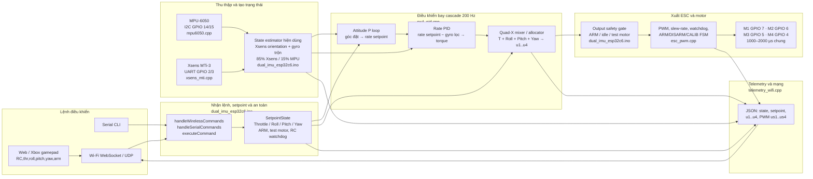
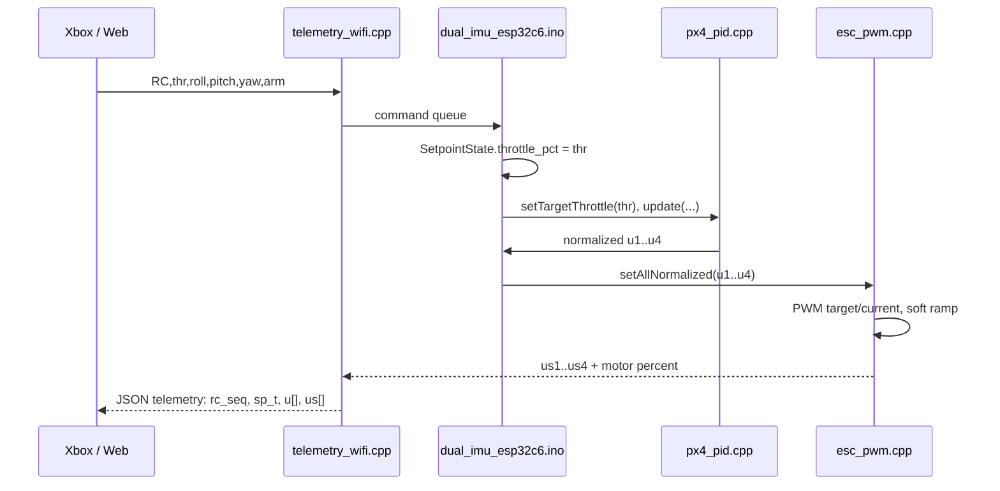

# Sơ đồ khối điều khiển và file C++ tương ứng

`dual_imu_esp32c6.ino` là entry point và nơi ghép các khối. Vòng điều khiển chính chạy ở 200 Hz; nhận lệnh mạng/Serial, phát telemetry và các tác vụ giao tiếp được gọi trong cùng `loop()`.

## Bảng ghép khối với source

| Khối | File thực thi | Nhiệm vụ chính |
|---|---|---|
| Entry point, lệnh, setpoint, safety gate | `dual_imu_esp32c6.ino` | `setup()`, `loop()`, parse RC/CLI, `SetpointState`, watchdog RC, gọi controller và đưa lệnh cuối tới ESC |
| Đọc MPU-6050 | `mpu6050.cpp` | I2C, hiệu chuẩn gyro, dữ liệu accelerometer/gyro, Roll/Pitch khi chạy MPU độc lập |
| Đọc Xsens MTi-3 | `xsens_mti.cpp` | UART/Xbus, orientation, acceleration và gyro từ AHRS Xsens |
| Lọc dữ liệu | `px4_filters.cpp` | Low-pass filter bậc hai dùng cho gyro/D-term trong controller |
| Vòng góc, rate PID, mixer | `px4_pid.cpp` | Attitude P loop, rate PID, anti-windup, giới hạn mô-men, Quad-X allocation/desaturation |
| PWM và ESC state machine | `esc_pwm.cpp` | LEDC PWM, dải 1000–2000 µs chung, soft ramp, ARM/DISARM, failsafe, calibration |
| Wi-Fi và WebSocket | `telemetry_wifi.cpp` | STA/AP, WebSocket server, queue lệnh mạng, UDP, telemetry JSON |

## Module có trong thư mục nhưng chưa nằm trên luồng đang chạy

`px4_ekf.cpp` có lớp `PX4_EKF`, nhưng file `.ino` hiện không include hoặc gọi `PX4_EKF::update()`. Trạng thái attitude đang dùng được dựng trực tiếp trong `loop()` từ orientation Xsens và gyro trộn. Vì vậy không nên vẽ `px4_ekf.cpp` là khối đang hoạt động cho đến khi nó được nối vào `dual_imu_esp32c6.ino`.

## Chuỗi điều khiển cần quan sát khi debug throttle

Khi ga chưa tới 2%, `dual_imu_esp32c6.ino` áp dụng idle chung `1050 µs`. Khi DISARM, `esc_pwm.cpp` giữ bốn kênh tại `1000 µs`.
