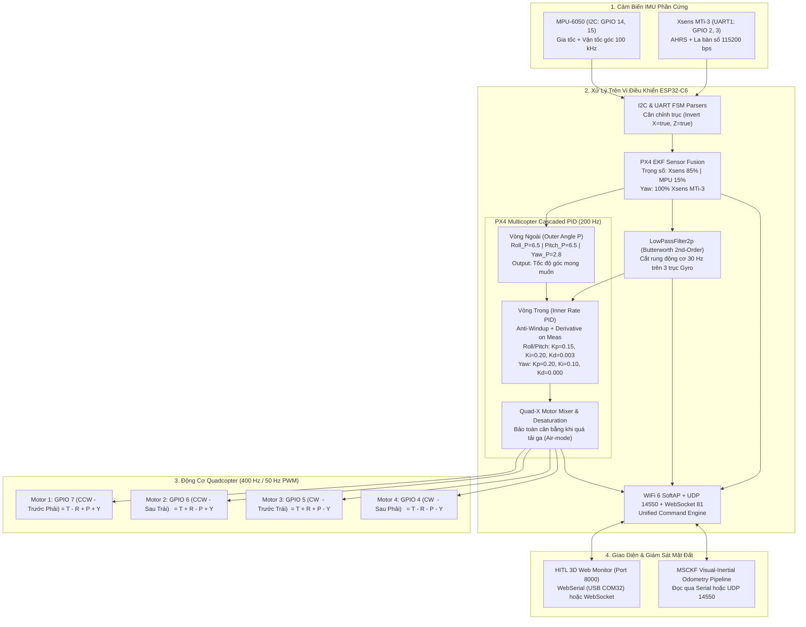

# 📘 TÀI LIỆU KỸ THUẬT: FIRMWARE ALL-IN-ONE FLIGHT CONTROLLER (ESP32-C6)
## DUAL-IMU FUSION · BUTTERWORTH FILTER · PX4 CASCADED PID · WIRELESS TELEMETRY

> **Dành cho Kỹ sư Nghiên cứu và AI Agent kế nhiệm**  
> Firmware này được phát triển cho bo mạch **ESP32-C6 (RISC-V 32-bit @ 160MHz)**, đóng vai trò **Flight Controller (FC) All-in-One kết hợp Telemetry Transceiver**:
> 1. Thu thập đa cảm biến IMU (InvenSense MPU-6050 + Xsens MTi-3 AHRS).
> 2. Dung hợp dữ liệu EKF chuẩn PX4 (Extended Kalman Filter).
> 3. Lọc rung nhiễu cơ khí động cơ bằng bộ lọc số **Butterworth bậc 2 (Cutoff 30Hz)**.
> 4. Bộ điều khiển bay 2 tầng nối tiếp **PX4 Cascaded PID** (Outer Angle P + Inner Rate PID + Quad-X Mixer Desaturation).
> 5. Phát sóng WiFi 6 SoftAP (`ESP32-UAV-FC`), UDP Telemetry (Port 14550) và WebSocket Server (Port 81) truyền trực tiếp lên Web 3D Monitor và MSCKF VIO.

---

## 📌 1. Sơ Đồ Khối Kiến Trúc Toàn Diện (System Architecture)



---

## 📌 2. Chi Tiết Thuật Toán Lọc & Điều Khiển PX4

### 2.1. Bộ Lọc Thông Thấp Bậc 2 Butterworth (`px4_filters.h/.cpp`)
- Khớp 100% mã nguồn `math::LowPassFilter2p` trong PX4 Autopilot.
- Sử dụng biến đổi song tuyến tính (Bilinear Transform / Tustin) với bù biến dạng tần số (Pre-warping):
  $$\omega_a = \tan\left(\frac{\pi f_c}{f_s}\right), \quad c = 1 + \sqrt{2}\omega_a + \omega_a^2$$
  $$b_0 = \frac{\omega_a^2}{c}, \quad b_1 = 2b_0, \quad b_2 = b_0$$
  $$a_1 = \frac{2(\omega_a^2 - 1)}{c}, \quad a_2 = \frac{1 - \sqrt{2}\omega_a + \omega_a^2}{c}$$
- Triển khai theo cấu trúc **Direct Form II Transposed** với bảo vệ chống tràn NaN/Inf và chống giật khi reset.
- Tần số cắt mặc định: **$f_c = 30\,\text{Hz}$** trên chu kỳ lấy mẫu **$f_s = 200\,\text{Hz}$** (loại bỏ hoàn toàn rung động tần số cao do cánh quạt quay ở $5000 \div 12000\,\text{RPM}$).

### 2.2. Bộ Điều Khiển PID 2 Tầng Nối Tiếp (`px4_pid.h/.cpp`)
1. **Vòng Ngoài (Outer Loop - Attitude P Controller)**:
   - Nhận sai số góc nghiêng giữa Setpoint người lái và góc Euler ước lượng từ PX4 EKF.
   - Xử lý quấn góc $\pm 180^\circ$ cho trục Yaw (`wrapAngle180`).
   - Ngõ ra là tốc độ góc mục tiêu $(\omega_{x,\text{sp}}, \omega_{y,\text{sp}}, \omega_{z,\text{sp}})$ bị chặn ở $\pm 220^\circ/\text{s}$.
2. **Vòng Trong (Inner Loop - Angular Rate PID Controller)**:
   - Nhận sai số tốc độ góc giữa Setpoint vòng ngoài và Gyro đã qua lọc Butterworth.
   - Thành phần vi phân: **Derivative on Measurement** (tính đạo hàm trên biến đo của Gyro, không tính trên sai số) để triệt tiêu cú giật (Spike Kick) khi người lái thay đổi Setpoint đột ngột.
   - Lọc thông thấp bậc 1 ($30\,\text{Hz}$) riêng cho thành phần $D$ để ngăn khuếch đại nhiễu trắng.
   - Bộ tích phân $I$: Tích hợp **Anti-Windup Clamping** ($\le \pm 0.3$) và tự động ngắt/reset khi mức ga ở dưới ngưỡng khởi động ($< 10\%$) để chống lật xe khi đang ở trên mặt đất.
3. **Bộ Phối Trộn Động Cơ Quad-X & Chống Bão Hòa (Mixer Desaturation)**:
   - Phân bổ lực chuẩn hình học:
     $$\begin{aligned}
     M_1 (\text{FR, CCW}) &= \text{Throttle} - \tau_{\text{roll}} + \tau_{\text{pitch}} + \tau_{\text{yaw}} \\
     M_2 (\text{RL, CCW}) &= \text{Throttle} + \tau_{\text{roll}} - \tau_{\text{pitch}} + \tau_{\text{yaw}} \\
     M_3 (\text{FL, CW})  &= \text{Throttle} + \tau_{\text{roll}} + \tau_{\text{pitch}} - \tau_{\text{yaw}} \\
     M_4 (\text{RR, CW})  &= \text{Throttle} - \tau_{\text{roll}} - \tau_{\text{pitch}} - \tau_{\text{yaw}}
     \end{aligned}$$
   - Thuật toán **Desaturation / Air-Mode**: Khi một động cơ chạm trần ($> 100\%$) hoặc chạm sàn ($< 5\%$), dịch chuyển đều toàn bộ mức ga của 4 động cơ để giữ nguyên chênh lệch mô-men Roll/Pitch, đảm bảo drone không bị lật mất kiểm soát khi tăng ga đột ngột.

---

## 📌 3. Bảng Tham Số Mặc Định (Tuning Parameters)

| Vòng Điều Khiển | Trục | $K_p$ | $K_i$ | $K_d$ | Giới hạn |
| :--- | :--- | :--- | :--- | :--- | :--- |
| **Outer Angle P** | Roll | `6.50` | - | - | Max $\pm 220^\circ/\text{s}$ |
| **Outer Angle P** | Pitch | `6.50` | - | - | Max $\pm 220^\circ/\text{s}$ |
| **Outer Angle P** | Yaw | `2.80` | - | - | Max $\pm 150^\circ/\text{s}$ |
| **Inner Rate PID**| Roll | `0.1500` | `0.2000` | `0.0030` | I-Max $\pm 0.30$ |
| **Inner Rate PID**| Pitch | `0.1500` | `0.2000` | `0.0030` | I-Max $\pm 0.30$ |
| **Inner Rate PID**| Yaw | `0.2000` | `0.1000` | `0.0000` | I-Max $\pm 0.25$ |
| **Gyro Filter**   | X, Y, Z | Cutoff = $30.0\,\text{Hz}$ | Butterworth Bậc 2 | - | $f_s = 200\,\text{Hz}$ |

---

## 📌 4. Bảng Lệnh Điều Khiển CLI (Serial USB & WiFi Telemetry)

| Lệnh | Ý nghĩa | Ví dụ |
| :--- | :--- | :--- |
| `arm` | Mở khóa an toàn 4 động cơ, sẵn sàng bộ điều khiển PID | `arm` |
| `disarm` / `stop` | Khóa khẩn cấp, ngắt ga về $900\,\mu\text{s}$, reset bộ tích phân | `disarm` |
| `throttle <pct>` | Đặt mức ga tổng thể cho Quadcopter ($0 \div 100\%$) | `throttle 25` |
| `sp <r> <p> <y>` | Đặt góc nghiêng mục tiêu (Setpoint Roll, Pitch, Yaw) | `sp 0 0 0` |
| `pid` | Xem toàn bộ hệ số PID và Setpoint hiện tại | `pid` |
| `pid roll <p> <i> <d>` | Tinh chỉnh PID tốc độ góc Roll trong thời gian thực | `pid roll 0.16 0.22 0.003` |
| `pid pitch <p> <i> <d>`| Tinh chỉnh PID tốc độ góc Pitch | `pid pitch 0.16 0.22 0.003` |
| `pid yaw <p> <i> <d>`  | Tinh chỉnh PID tốc độ góc Yaw | `pid yaw 0.22 0.12 0.000` |
| `pid angle <rp> <pp> <yp>` | Tinh chỉnh hệ số P vòng ngoài của 3 góc | `pid angle 6.0 6.0 2.5` |
| `m1` / `m2` / `m3` / `m4` | Thử nghiệm thủ công từng động cơ riêng lẻ | `m1 15` |
| `freq <50\|400>` | Đổi tần số xung PWM phần cứng (50Hz ESC Vàng, 400Hz PX4) | `freq 400` |
| `calib_start` / `calib_finish` | Hiệu chuẩn hành trình ga ESC đồng loạt 4 kênh | `calib_start` |
| `status` | Xem bảng trạng thái chi tiết 4 kênh xung và GPIO | `status` |

---

## 📌 5. Quy Trình Vận Hành & Giám Sát Web 3D

1. **Khởi chạy Giao diện Giám sát**:
   ```bash
   python tools/run_monitor_web.py
   ```
   Trình duyệt tự động mở: `http://localhost:8000/UAV%20HITL%20Testbed%20Monitor.html`.
2. **Kết nối Telemetry**:
   - **Cách 1 (Khuyên dùng khi cắm cáp)**: Nhấn nút **`[⚡ Cáp USB (COM)]`**, chọn cổng `COM32` $\rightarrow$ Nhận dữ liệu tức thời 0ms, không lag, không cần đổi mạng WiFi.
   - **Cách 2 (Không dây)**: Kết nối Laptop vào WiFi `ESP32-UAV-FC` (Pass: `dronebridge`), nhấn **`[📡 Sóng WiFi (AP)]`** $\rightarrow$ Kết nối qua WebSocket `ws://192.168.4.1:81`.
3. **Thao Tác Bay Trực Quan**:
   - Nhấn **`[ARM]`** để mở khóa.
   - Kéo thanh trượt **`MỨC GA (THROTTLE)`** hoặc chọn nút nhanh `15%`, `30%`.
   - Nhấn nút **`[⚖️ Cân Bằng (0°)]`** để giữ thăng bằng tuyệt đối bằng vòng PID EKF.
