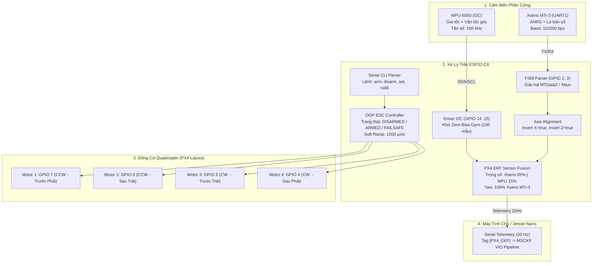

# 📘 TÀI LIỆU KỸ THUẬT: FIRMWARE DUAL-IMU FUSION & QUAD ESC CONTROLLER TRÊN ESP32-C6

> **Dành cho Kỹ sư Nghiên cứu và AI Agent kế nhiệm**  
> Firmware này được lập trình tối ưu cho bo mạch **ESP32-C6 (RISC-V 32-bit)**, thực hiện thu thập đa cảm biến quán tính, dung hợp dữ liệu bằng bộ lọc EKF chuẩn PX4 và điều khiển 4 kênh động cơ Quadcopter.

---

## 📌 1. Tổng Quan Kiến Trúc (System Overview)

Hệ thống nhúng giải quyết 3 bài toán kỹ thuật cốt lõi trong phòng thí nghiệm ISILAB:
1. **Thu thập dữ liệu song song từ 2 cảm biến IMU khác loại**:
   - **InvenSense MPU-6050 (6-DoF)**: Giá thành thấp, tần số lấy mẫu cao, phản hồi tức thời qua bus I2C.
   - **Xsens MTi-3 (AHRS)**: Cấp công nghiệp, tích hợp từ kế số và thuật toán AHRS nội, xuất dữ liệu góc tuyệt đối (True North) qua bus UART1.
2. **Dung hợp cảm biến EKF (Extended Kalman Filter) chuẩn PX4**:
   - Triệt tiêu hoàn toàn hiện tượng trôi (drift) của MPU-6050 bằng cách lấy mốc Yaw từ Xsens MTi-3 ($100\%$).
   - Kết hợp gia tốc và vận tốc góc với trọng số tin cậy: **Xsens 85% ($0.85$), MPU-6050 15% ($0.15$)**.
3. **Phân hệ điều khiển 4 động cơ Quadcopter (OOP ESC PWM Controller)**:
   - Phát xung PWM phần cứng độ phân giải 14-bit siêu mịn ($0.15\,\mu\text{s}$).
   - Xung ngắt an toàn chuẩn PX4 ($900\,\mu\text{s}$) chống lỗi ESC kêu bíp liên tục khi cấp nguồn.
   - Cơ chế bảo vệ Failsafe Watchdog (tự ngắt ga sau 3 giây mất kết nối) và Soft Ramp Limiter ($1500\,\mu\text{s/s}$) chống sốc dòng.



---

## 🔌 2. Sơ Đồ Chân Phần Cứng (Hardware Pinout)

Tất cả các chân GPIO được phân bổ tối ưu cho bo mạch **ESP32-C6**, hoàn toàn tránh các chân Boot Strapping nhạy cảm:

| Module / Thiết bị | Chân thiết bị | Chân ESP32-C6 | Chuẩn giao tiếp | Đặc tả kỹ thuật |
| :--- | :--- | :--- | :--- | :--- |
| **MPU-6050** | SDA | **GPIO 14** | I2C Data | Kéo trở treo $4.7\,\text{k}\Omega$ lên 3.3V |
| **MPU-6050** | SCL | **GPIO 15** | I2C Clock | Tần số $100\,\text{kHz}$ |
| **MPU-6050** | VCC / GND | 3.3V / GND | Nguồn | Dùng nguồn 3.3V sạch từ LDO |
| **Xsens MTi-3** | TX (Xsens phát) | **GPIO 2** (RX1) | UART1 Serial | Nhận byte nhị phân giao thức Xbus |
| **Xsens MTi-3** | RX (Xsens nhận) | **GPIO 3** (TX1) | UART1 Serial | Baudrate: **115200 bps**, 8-N-1 |
| **Xsens MTi-3** | VCC / GND | 3.3V / GND | Nguồn | Nối chung GND với ESP32-C6 |
| **ESC Motor 1** | Tín hiệu PWM | **GPIO 7** | Hardware PWM | Motor 1 (Trước-Phải): **CCW** (Ngược kim đồng hồ) |
| **ESC Motor 2** | Tín hiệu PWM | **GPIO 6** | Hardware PWM | Motor 2 (Sau-Trái): **CCW** (Ngược kim đồng hồ) |
| **ESC Motor 3** | Tín hiệu PWM | **GPIO 5** | Hardware PWM | Motor 3 (Trước-Trái): **CW** (Thuận kim đồng hồ) |
| **ESC Motor 4** | Tín hiệu PWM | **GPIO 4** | Hardware PWM | Motor 4 (Sau-Phải): **CW** (Thuận kim đồng hồ) |

---

## 📂 3. Cấu Trúc Mã Nguồn Firmware

```text
firmware/dual_imu_esp32c6/
├── dual_imu_esp32c6.ino   # Chương trình chính (Setup, Loop, Telemetry, CLI)
├── mpu6050.h / .cpp       # Driver I2C MPU-6050 + Thuật toán khử Zero-Bias
├── xsens_mti.h / .cpp     # FSM Parser giải mã MTData2 nhị phân + Đồng bộ trục
├── px4_ekf.h / .cpp       # Bộ lọc Kalman mở rộng (EKF) dung hợp Quaternion
├── esc_pwm.h / .cpp       # Hệ thống điều khiển OOP 4 động cơ ESC PWM chuẩn PX4
└── README.md              # Tài liệu kỹ thuật này
```

---

## 🔬 4. Phân Tích Kỹ Thuật Chi Tiết Các Phân Hệ

### 4.1. Phân hệ MPU-6050 (`mpu6050.cpp`)
- **Khởi tạo & Khử lệch tĩnh**: Trong hàm `setup()`, gọi `mpu6050_calibrate_gyro(100)` thu thập 100 mẫu liên tiếp khi drone đứng yên, tính toán bù độ lệch tĩnh $(\Delta gx, \Delta gy, \Delta gz)$.
- **Thu thập dữ liệu**: Đọc tuần tự 14 byte từ thanh ghi `0x3B` (`ACCEL_XOUT_H`) qua I2C Burst Read.
- **Tính toán góc Euler thô**:
  $$\text{Roll}_{acc} = \text{atan2}(a_y, a_z) \cdot \frac{180}{\pi}, \quad \text{Pitch}_{acc} = \text{atan2}(-a_x, \sqrt{a_y^2 + a_z^2}) \cdot \frac{180}{\pi}$$

### 4.2. Phân hệ Xsens MTi-3 (`xsens_mti.cpp`)
- **Máy trạng thái Non-blocking FSM**: Đọc luồng byte từ UART1 mà không sử dụng bất kỳ lệnh `delay()` nào, đảm bảo vòng lặp thời gian thực đạt tốc độ tối đa.
- **Giải mã định dạng Xbus / MTData2**:
  - `0xFA 0xFF 0x36 [LEN] [DATA] [CHECKSUM]`
  - Trường dữ liệu: `0x2030` (Euler Angles), `0x2010` (Quaternion), `0x4020` (Gia tốc Calibrated $m/s^2$), `0x8020` (Vận tốc góc $deg/s$).
  - Kiểm tra tính toàn vẹn bằng **Two's Complement Checksum**.
- **Đồng bộ hệ quy chiếu 3D (`Axis Alignment`)**:
  Do Xsens gắn ngược mặt so với MPU-6050 trên bo mạch thử nghiệm, hàm `xsens_mti_set_axis_inversion(true, false, true)` sẽ tự động:
  - Đảo dấu trục X (`pitch = -raw_pitch`).
  - Chuẩn hóa trục Z và lật góc Roll lệch $180^\circ$ về đúng hệ quy chiếu cơ sở của Robot.

### 4.3. Bộ Lọc Dung Hợp PX4 EKF (`px4_ekf.cpp`)
- **Biểu diễn không gian**: Sử dụng Quaternion đơn vị $\mathbf{q} = [q_0, q_1, q_2, q_3]^T$.
- **Bước Dự Báo (Prediction)**:
  Tích phân vận tốc góc dung hợp $\boldsymbol{\omega} = w_{xsens} \cdot \boldsymbol{\omega}_{xsens} + w_{mpu} \cdot \boldsymbol{\omega}_{mpu}$ vào Quaternion theo chu kỳ thời gian $dt$:
  $$\mathbf{q}_{k+1} = \mathbf{q}_k + \frac{1}{2} \mathbf{q}_k \otimes \begin{bmatrix} 0 \\ \boldsymbol{\omega} \end{bmatrix} dt$$
- **Bước Hiệu Chỉnh (Update)**:
  - Cân bằng sai số góc nghiêng (Roll, Pitch) dựa trên ma trận hiệp phương sai đo lường $R$.
  - **Trọng số tin cậy**: Xsens $85\%$ ($w_{xsens}=0.85$), MPU-6050 $15\%$ ($w_{mpu}=0.15$).
  - **Khóa trục Yaw**: Trục Yaw được **gán trực tiếp $100\%$ theo Xsens MTi-3**, loại bỏ hoàn toàn hiện tượng trôi góc la bàn của MPU-6050.

### 4.4. Phân Hệ Điều Khiển 4 Động Cơ Quadcopter (`esc_pwm.cpp`)
- **Thiết kế hướng đối tượng (OOP)**:
  - Lớp `EscMotor`: Quản lý từng kênh động cơ riêng biệt (Chân GPIO, chiều quay CW/CCW, độ rộng xung hiện tại, giới hạn độ dốc).
  - Lớp `QuadMotorController`: Quản lý đồng bộ 4 động cơ, FSM an toàn và Failsafe Watchdog.
- **Thông số xung chuẩn PX4**:
  - `ESC_PULSE_DISARM_US = 900 µs`: Xung ngắt an toàn (chống lỗi ESC kêu tiếng bíp bíp liên tục khi vừa cấp nguồn).
  - `ESC_PULSE_MIN_US = 1000 µs`: Điểm ga $0.0\%$.
  - `ESC_PULSE_MAX_US = 2000 µs`: Điểm ga tối đa $100.0\%$.
  - `ESC_PULSE_IDLE_US = 1050 µs`: Xung quay chậm không tải sau khi Arm (Idle spin $5\%$).
- **Cơ chế an toàn chủ động**:
  1. **Quy trình Arming an toàn (2 giây)**: Giữ xung $1000\,\mu\text{s}$ trong 2 giây trước khi cho phép nhận lệnh ga.
  2. **Soft Ramp / Slew Rate Limiter ($1500\,\mu\text{s/s}$)**: Hạn chế tốc độ thay đổi xung ga đột ngột, chống sụt áp pin LiPo và bảo vệ motor.
  3. **Failsafe Watchdog (3 giây)**: Tự động hạ ga về $900\,\mu\text{s}$ nếu không có lệnh điều khiển trong 3 giây.

---

## 📡 5. Định Dạng Dữ Liệu Serial Telemetry (Giao Thức Giao Tiếp VIO)

Mỗi $50\,\text{ms}$ (tần số $20\,\text{Hz}$), ESP32-C6 xuất luồng dữ liệu chuẩn qua cổng Serial (`115200 baud`):

```text
-----------------------------------------------------------------------------------------------------------------
[MPU6050] R:   1.2° P:  -0.5° Y:   3.1° | Acc:[  0.02,  0.01,  9.81] | Gyr:[   0.1,  -0.2,   0.0]
[Xsens  ] R:   1.1° P:  -0.6° Y:  45.0° | Acc:[  0.01,  0.00,  9.79] | Gyr:[   0.0,  -0.1,   0.0]
[PX4_EKF] R:   1.1° P:  -0.6° Y:  45.0° | Acc:[  0.01,  0.00,  9.80] | Gyr:[   0.0,  -0.1,   0.0] (OPTIMAL)
[ESC_QUAD] State:ARMED    | M1(P7-CCW):1150us(15.0%) | M2(P6-CCW):1150us(15.0%) | M3(P5-CW):1150us(15.0%) | M4(P4-CW):1150us(15.0%) @ 50Hz
```

> [!IMPORTANT]
> **Điểm neo tích hợp thuật toán VIO**:
> Pipeline VIO trên máy tính (`vio_system/imu_stream.py`) sẽ lọc chính xác thẻ **`[PX4_EKF]`** để làm đầu vào quán tính cho bộ lọc **MSCKF**, kết hợp cùng camera ngoài để tạo thành hệ thống định vị tích hợp Visual-Inertial Odometry 6-DoF hoàn chỉnh.

---

## 💻 6. Bảng Tra Cứu Lệnh Serial CLI (Điều Khiển Động Cơ)

Người dùng có thể gõ trực tiếp các lệnh sau vào Serial Monitor của Arduino IDE / PlatformIO / Python terminal:

| Lệnh Serial | Mô tả chức năng | Ví dụ cú pháp |
| :--- | :--- | :--- |
| `arm` | Mở khóa an toàn 4 động cơ (chờ 2 giây phát nhạc khởi động) | `arm` |
| `disarm` / `stop` | Khóa khẩn cấp toàn bộ động cơ (ngắt xung về $900\,\mu\text{s}$) | `disarm` |
| `set all <%>` | Đặt mức ga đồng loạt cho cả 4 động cơ ($0 - 100\%$) | `set all 15` |
| `m1 <%>` | Đặt ga riêng cho Motor 1 (GPIO 7 - CCW) | `m1 12.5` |
| `m2 <%>` | Đặt ga riêng cho Motor 2 (GPIO 6 - CCW) | `m2 15` |
| `m3 <%>` | Đặt ga riêng cho Motor 3 (GPIO 5 - CW) | `m3 12.5` |
| `m4 <%>` | Đặt ga riêng cho Motor 4 (GPIO 4 - CW) | `m4 15` |
| `pwm <us>` | Đặt độ rộng xung trực tiếp ($1000 - 2000\,\mu\text{s}$) | `pwm 1200` |
| `freq <hz>` | Đổi tần số PWM ($50\,\text{Hz}$ tương thích cao hoặc $400\,\text{Hz}$ PX4) | `freq 400` |
| `calib_start` | Bắt đầu hiệu chuẩn hành trình ga ESC (phát xung Max $2000\,\mu\text{s}$) | `calib_start` |
| `calib_finish` | Hoàn tất hiệu chuẩn hành trình ga (hạ xung Min $900\,\mu\text{s}$) | `calib_finish` |
| `status` | Xuất bảng trạng thái chi tiết từng chân, chiều quay và độ rộng xung | `status` |
| `help` | Hiển thị bảng trợ giúp danh sách lệnh | `help` |

---

## 🤖 7. Chỉ Dẫn Kỹ Thuật Dành Riêng Cho AI Agent Kế Nhiệm

Khi tiếp quản hoặc chỉnh sửa codebase này, AI Agent cần tuân thủ các quy tắc sau:

1. **Thay đổi cấu hình chân**:
   Chỉ chỉnh sửa tại các macro `#define` ở đầu file [`dual_imu_esp32c6.ino`](./dual_imu_esp32c6.ino#L11-L22). Không hard-code số chân GPIO rải rác trong các file `.cpp`.
2. **Cấu hình lại trọng số tin cậy EKF**:
   Nếu thay đổi cảm biến hoặc môi trường rung lắc mạnh, hãy gọi hàm:
   ```cpp
   ekf.setSensorWeights(xsens_weight, mpu_weight);
   ```
   *Lưu ý: Luôn đảm bảo tổng trọng số $w_{xsens} + w_{mpu} = 1.0$.*
3. **Tuyệt đối không dùng `delay()` trong vòng `loop()`**:
   Hàm `loop()` phải chạy ở chế độ non-blocking hoàn toàn để duy trì FSM đọc UART và bảo toàn tần số cập nhật PWM mượt mà cho 4 động cơ.
4. **Nạp Firmware**:
   - Sử dụng Arduino IDE (v2.x) hoặc PlatformIO.
   - Board: **ESP32C6 Dev Module**.
   - Flash Size: 4MB, Flash Frequency: 80MHz.
   - Upload Speed: 921600 hoặc 115200.
